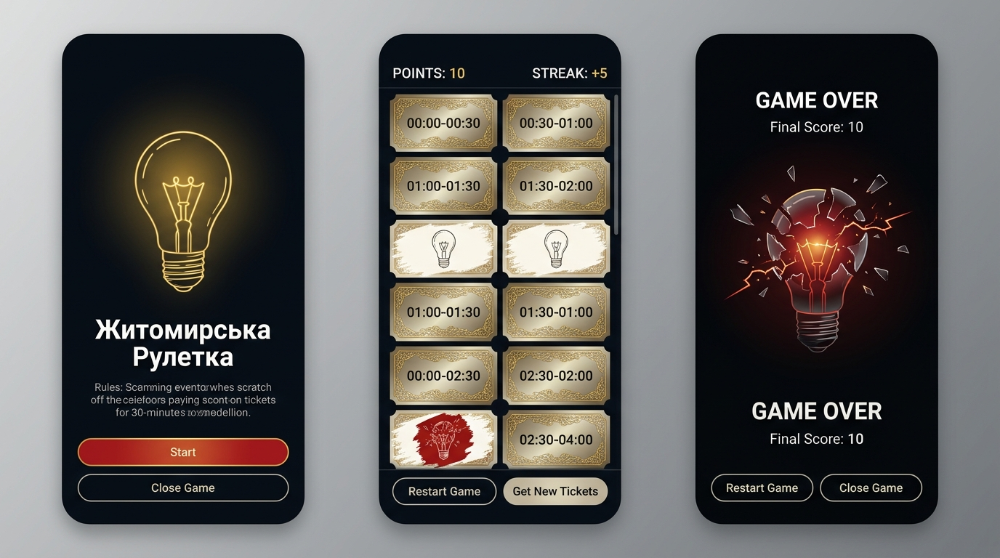

# Житомирська Рулетка (Scratch-Off Blackout Lottery Mini-Game)

An interactive scratch-off lottery mini-game launched from a new **"Житомирська Рулетка"** button at the bottom of the About window (right after the Donations block). Players test their luck by scratching 48 half-hour timeslot tickets arranged in a **2-column hourly grid** (`00:00-00:30` and `00:30-01:00` per row), populated from a randomly selected live ZTOE blackout queue (or randomized offline) to reveal safe beige lightbulbs for escalating streak points while avoiding center-red blackout tickets.

---

## User Review & Critical Decisions

> [!IMPORTANT]
> Please review the updated localization, UI mockup, and design/audio specifications below. Once you click **Proceed**, both the native Android (Kotlin + Jetpack Compose) implementation and the Web Simulator (React + TypeScript) implementation will be built and verified with automated unit tests.

- **Bilingual Interface (`uk` / `en` Synchronized with Main App Settings)**: All game screens, HUD counters, rules text, and buttons dynamically render in **Ukrainian (`uk`)** or **English (`en`)** based on the Main Application's language setting (`language` / `AppStrings`), while the launch button in the About window after the Donations block is titled **"Житомирська Рулетка"**.
- **Entry Point Placement**: A new button titled **"Житомирська Рулетка"** is added at the end of the About window (immediately below the `Donations / Благодійність і Пожертви` card), preserving all existing UI elements, icons, colors, and positions untouched.
- **2-Column Hourly Grid (`00:00-00:30` | `00:30-01:00` through `23:00-23:30` | `23:30-24:00`)**: The 48 lottery tickets are arranged in 24 rows of 2 columns, pairing the two 30-minute timeslots of each hour side-by-side.
- **Unscratched Ticket Golden Embroidery**: Unscratched tickets feature a metallic glance foil surface adorned with **intricate golden filigree embroidery** along the borders and corners, with the timeslot label (`00:00-00:30`, `15:30-16:00`, etc.) printed in the center.
- **Center-Only Red Reveal (Anti-Spoiler Design)**: Scratched-off Red tickets share the exact same warm beige outer background (`#D8D6CC` / `#FCFBF7` / `#CCC9BE`) around their edges and perimeter as safe Beige tickets, placing the crimson Red color (`#9E1E18` / `#D62E26` / `#8C1914`) and exploded lightbulb contour **strictly in the center medallion** so scratching the edges does not reveal a red ticket prematurely.
- **Two-Stage Red Ticket Audio & Game Over Sequence**: Revealing a Red ticket plays an **electric buzzing sound while the screen fades to black**, followed immediately by the **sound of an exploding lightbulb** synchronized with the shattering lightbulb animation.

---

## 1. Overview & Core Concept

- **What It Does**: Turns the 48 half-hour blackout timeslots of a Zhytomyroblenergo schedule into a tactile scratch-off lottery game inside the application.
- **Target Audience / Persona**: Users of **Світло в Житомирі** looking for a playful, thematic way to pass the time during or between scheduled power outages.
- **Key Value**: Blends the authentic САЗУ-ИТ electricity meter palette (warm enamel beige `#FCFBF7` / `#D8D6CC` and deep crimson `#D62E26` / `#9E1E18`) with luxury golden-embroidered scratch-card aesthetics, procedural sound synthesis, bilingual (`uk`/`en`) localization, and risk-vs-reward streak scoring.

---

## 2. User Experience, Localization & Visual Design

### Visual Mockup Preview



### Bilingual Localization Table (`uk` / `en`)

The game reads the active application language (`uk` or `en`) from Main Application settings and localizes all in-game UI text accordingly:

| UI Element | Ukrainian (`uk`) | English (`en`) |
|---|---|---|
| **About Window Button** | Житомирська Рулетка | Житомирська Рулетка |
| **Game Title** | Житомирська Рулетка | Zhytomyr Roulette |
| **Start Screen Description** | Стирайте захисний шар із 30-хвилинних слотів графіка. Світлий білет із цілою лампочкою додає бали (+1, +2, +3...), а червоний білет призводить до блекауту! | Scratch off the 30-minute timeslot tickets. Each beige ticket with an intact lightbulb increases your score (+1, +2, +3...), while a red ticket triggers a blackout! |
| **Start Button** | Почати гру | Start |
| **Close Game Button** | Закрити гру | Close Game |
| **Top HUD Points Counter** | Бали: `0` (Серія: `+1`) | Points: `0` (Streak: `+1`) |
| **Restart Game Button** | Спочатку | Restart Game |
| **Get New Tickets Button** | Нові білети | Get New Tickets |
| **Game Over Header** | БЛЕКАУТ! ГРУ ЗАКІНЧЕНО | BLACKOUT! GAME OVER |
| **Final Score Label** | Фінальний рахунок: `X` | Final Score: `X` |

### Key User Flows

1. **Launching the Game**:
   - In the **About** window, below the `Donations / Благодійність і Пожертви` block, the user taps the **"Житомирська Рулетка"** button.
   - A full-screen modal window opens to the **Game Start Screen** in the user's selected application language (`uk` or `en`).
2. **Game Start Screen**:
   - Displays the localized title (**"Житомирська Рулетка"** / **"Zhytomyr Roulette"**), glowing contour lightbulb emblem, localized rules summary, and two action buttons: **"Почати гру" / "Start"** and **"Закрити гру" / "Close Game"**.
   - Tapping **"Закрити гру" / "Close Game"** dismisses the game window and returns to the **About** window.
   - Tapping **"Почати гру" / "Start"** initializes `score = 0` and `currentIncrement = 1`, loads a random blackout queue (`1.1`–`6.2`) from the ZTOE schedule (or generates a randomized beige/red distribution if offline), and transitions to the **Active Game Screen**.
3. **Active Game Screen (2-Column Grid of 48 Scratch-Off Tickets)**:
   - **Top Sticky HUD**: Displays the localized **Points Counter** (`Бали: 0` / `Points: 0`) starting from `0` (plus the current streak increment `+1`, `+2`, `+3`...).
   - **2-Column Hourly Ticket Grid (24 Rows x 2 Columns)**:
     - Each row represents one hour of the day, with the two 30-minute timeslots side-by-side (`00:00-00:30` on the left, `00:30-01:00` on the right, down to `23:00-23:30` and `23:30-24:00`).
     - **Unscratched Ticket Design**: Premium metallic glance surface with diagonal sheen, **intricate golden ornamental embroidery** framing the ticket perimeter and corners, and the timeslot text (`00:00-00:30`, `15:30-16:00`, etc.) centered on the foil.
     - **Swiping / Scratching Interaction**: As the user swipes their finger across a ticket, the golden-embroidered glance foil scratches away along the finger path while playing a **scratching sound**:
       - **Beige Ticket (Safe / Power ON)**: Warm beige background (`#D8D6CC` -> `#FCFBF7` -> `#CCC9BE`) across the entire ticket with a **contour drawing of an intact lightbulb** in the center. Plays a **coin sound** on reveal and increases the user's score by `currentIncrement` (`+1`, `+2`, `+3`, `+4`, etc.).
       - **Red Ticket (Blackout / Power OFF)**: Uses the same warm beige background (`#D8D6CC` -> `#FCFBF7` -> `#CCC9BE`) along the outer edges so edge-scratching does not give away the color early, with **crimson Red (`#9E1E18` -> `#D62E26` -> `#8C1914`) concentrated only in the center** behind the **contour drawing of an exploded lightbulb**. Once the center is scratched and revealed, triggers the **Red Ticket Reveal & Game Over Sequence**.
   - **Bottom Pinned Control Bar**:
     - **"Спочатку" / "Restart Game"**: Resets `score = 0` (and streak increment to `+1`) and returns to the **Game Start Screen**.
     - **"Нові білети" / "Get New Tickets"**: Retains the current `score`, resets the consecutive increment back to `+1`, loads a new random blackout queue (or randomized offline slots), and refreshes all 48 tickets to their unscratched golden-embroidered state.
4. **Red Ticket Reveal & Game Over Screen**:
   - **Stage 1 (Fade-to-Black + Electric Buzz)**: Upon revealing a Red ticket's center, an **electric buzzing sound** plays while the screen fades smoothly to pitch black (`#05070B`).
   - **Stage 2 (Exploding Lightbulb Animation + Explosion Sound)**: Once faded to black, the **sound of an exploding lightbulb** (glass shatter burst + filament pop) plays in sync with the **exploding lightbulb animation** (bright filament flash, flying glass shards, and radiating sparks).
   - Displays the player's localized **Final Score** (`Фінальний рахунок` / `Final Score`) and two buttons at the bottom:
     - **"Спочатку" / "Restart Game"**: Resets `score = 0` and returns to the **Game Start Screen**.
     - **"Закрити гру" / "Close Game"**: Closes the game window and returns to the **About** window.

---

## 3. Key Product Decisions & Trade-Offs

- **Decision 1: Four-Sound Procedural Audio Engine (Web Audio API & Android `AudioTrack` PCM Synthesizer)**
  - *Chosen Approach*: Synthesize all four distinct sound effects in real time:
    1. **Scratch Sound**: Bandpass-filtered noise burst during finger swipe over unscratched foil.
    2. **Coin Sound**: Crisp dual-tone metallic chime (`B5 -> E6`) on Beige ticket reveal.
    3. **Electric Buzz Sound**: Low-frequency sawtooth/square hum (`50Hz/100Hz` harmonic buzz with crackle modulation) playing while the screen fades to black on Red ticket reveal.
    4. **Exploding Lightbulb Sound**: Sharp transient filament pop + high-frequency glass-shatter noise bursts synchronized with the exploding lightbulb animation on the black Game Over screen.
- **Decision 2: Center-Weighted Reveal Detection & Anti-Spoiler Radial Mask**
  - *Chosen Approach*: Render the underlying ticket canvas with the warm beige gradient across 100% of the card surface and draw the red blackout medallion (`r ≈ 28%` of card width) strictly in the center around the exploded lightbulb contour. Track scratch coverage specifically across the central medallion zone so edge swipes never prematurely trigger or visually spoil a Red ticket.

---

## 4. Technical Architecture & Data Strategy *(Technical Reference)*

### Architecture & Component Diagram

```
┌──────────────────────────────────────────────────────────────────────────┐
│                     About Window (AboutScreen / AboutView)               │
│  [Project Links Card] -> [Donations Card] -> ["Житомирська Рулетка" Btn] │
└───────────────────────────────────────┬──────────────────────────────────┘
                                        │ Opens Full-Screen Game Overlay (lang = uk | en)
                                        ▼
┌──────────────────────────────────────────────────────────────────────────┐
│                   Zhytomyr Roulette State Machine & Controller           │
│   States: START ──► PLAYING (24x2 Grid) ──► FADING_BUZZ ──► GAME_OVER    │
│   State Store: score (0+), streakIncrement (1+), tickets[0..47], lang    │
└───────────┬───────────────────────────┬──────────────────────────┬───────┘
            │                           │                          │
            ▼                           ▼                          ▼
┌───────────────────────┐   ┌───────────────────────┐  ┌───────────────────┐
│ Queue & Slot Provider │   │ 2-Col Scratch Tickets │  │ Procedural Audio  │
│ - Picks random queue  │   │ - Golden embroidery   │  │ - Scratch friction│
│   (1.1 .. 6.2)        │   │ - Beige outer border  │  │ - Coin arpeggio   │
│ - Live ZTOE fetch     │   │ - Center-only Red     │  │ - Electric buzz   │
│ - Offline randomizer  │   │ - Bulb / Exploded SVG │  │ - Bulb explosion  │
└───────────────────────┘   └───────────────────────┘  └───────────────────┘
```

### Data Model & State Transitions

| State / Entity | Description & Transitions |
|---|---|
| `GameScreenState` | `'START'` \| `'PLAYING'` \| `'GAME_OVER'` (with two-stage fade + explosion transition) |
| `Language` | `'uk'` \| `'en'` passed directly from Main Application settings (`appLanguage` / `AppStrings`) |
| `RouletteTicket` | `{ index: 0..47, label: "00:00-00:30", isRed: boolean, scratchProgress: 0..1, isRevealed: boolean }` displayed in a 2-column grid (`row = Math.floor(index / 2)`, `col = index % 2`) |
| `score` | Starts at `0`. On Beige ticket reveal: `score += streakIncrement; streakIncrement += 1`. On `"Restart Game"`: `score = 0; streakIncrement = 1`. On `"Get New Tickets"`: `score` unchanged, `streakIncrement = 1`. |
| `Red Reveal Sequence` | `0ms–650ms`: Screen fades to black while `playElectricBuzzSound()` plays. `650ms+`: `playBulbExplosionSound()` fires simultaneously with the exploding lightbulb shatter animation, revealing Final Score + `"Restart Game"` / `"Close Game"`. |
