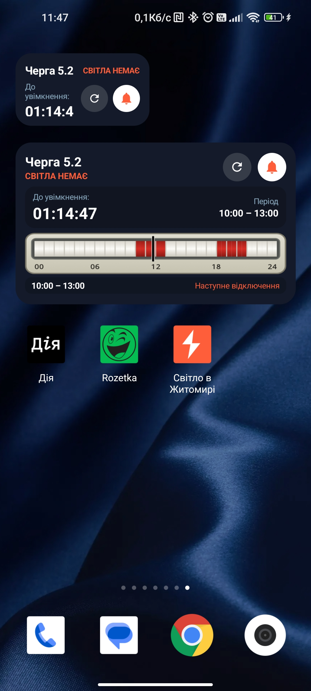
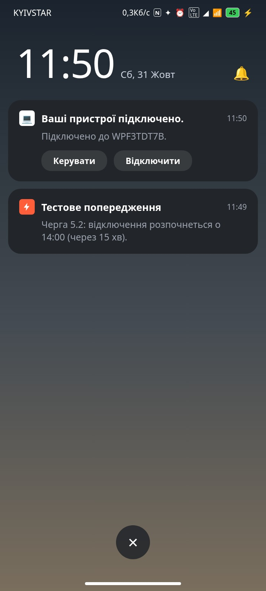
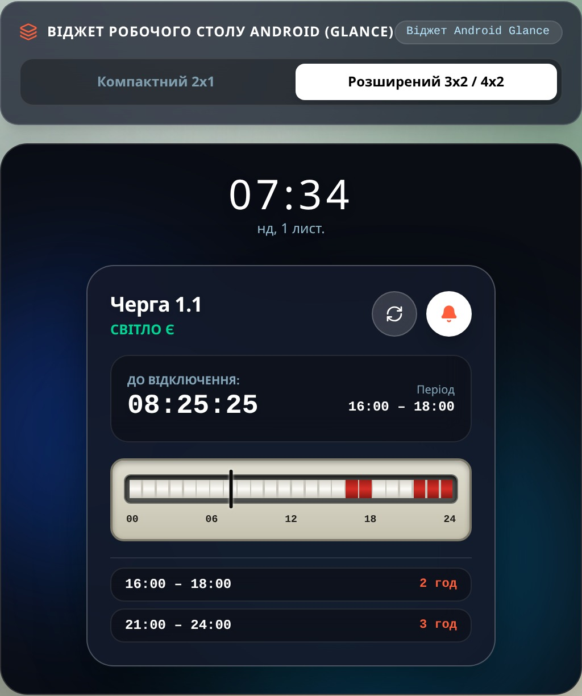
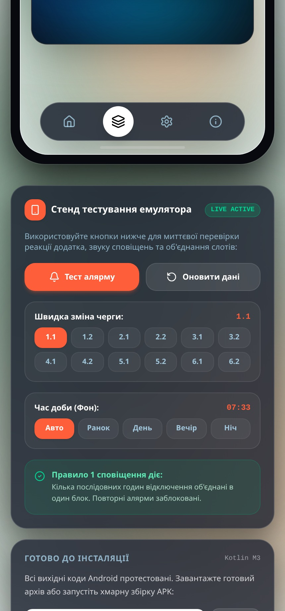
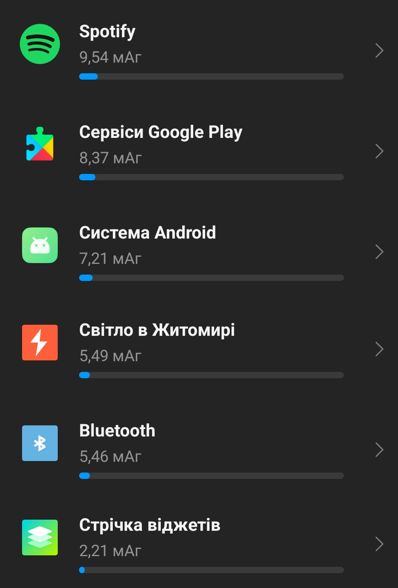
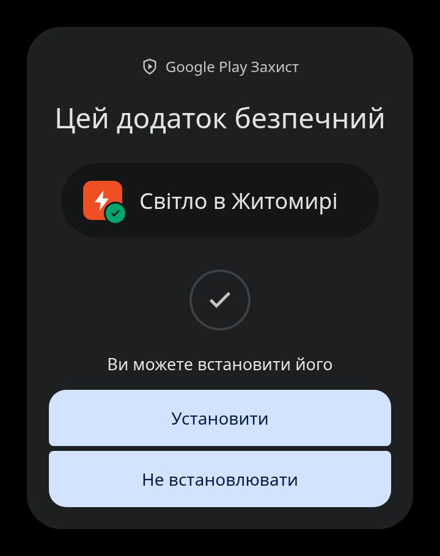
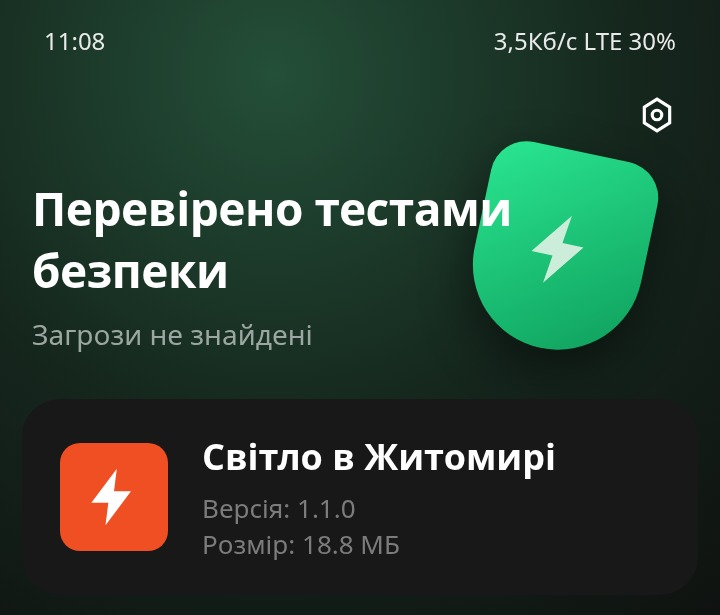

# Світло в Житомирі (Android-ZTBlackoutPreWarning) — Developer Handover & Architecture Guide

**Current Release Version:** `v1.4.0` (`versionCode = (GITHUB_RUN_NUMBER ?: 300) + 300`, `applicationId = appPkgEnv ?: "com.ZTBlackoutPreWarning"`, Kotlin `namespace = "ua.blackout.prewarning"`)  
**Repository:** `https://github.com/IgorZaharov/Android-ZTBlackoutPreWarning`  
**Data Source:** JSC "Zhytomyroblenergo" (`https://www.ztoe.com.ua/unhooking-search.php`)  
**Target Platforms:** Native Android 8.0–15 (`minSdk = 26`, `targetSdk = 35`, `compileSdk = 35`) + Interactive Web Simulator (React 19 + TypeScript + Vite)

---

## Table of Contents

1. [Executive Summary & Project Purpose](#1-executive-summary--project-purpose)
2. [Visual Overview & Application Screenshots](#2-visual-overview--application-screenshots)
3. [High-Level Architecture & Data Flow](#3-high-level-architecture--data-flow)
4. [Complete GitHub Repository File Reference](#4-complete-github-repository-file-reference)
5. [Detailed Breakdown of Core Subsystems, Classes, Methods & Rationale](#5-detailed-breakdown-of-core-subsystems-classes-methods--rationale)
   - [5.1 ZTOE HTML Scraper & 48 Half-Hour Slot Engine (`ZtoeParser.kt` / `ztoeParser.ts`)](#51-ztoe-html-scraper--48-half-hour-slot-engine-ztoeparserkt--ztoeparserts)
   - [5.2 Schedule Storage, Interval Aggregation & Countdown Engine (`ScheduleRepository.kt` / `ztoeParser.ts`)](#52-schedule-storage-interval-aggregation--countdown-engine-schedulerepositorykt--ztoeparserts)
   - [5.3 Exact Pre-Warning Alarms, Time-Change Resilience & Deduplication (`AlarmScheduler.kt`, `AlarmReceiver.kt`, `AlertRegistry.kt`)](#53-exact-pre-warning-alarms-time-change-resilience--deduplication-alarmschedulerkt-alarmreceiverkt-alertregistrykt)
   - [5.4 Background Periodic Sync & Boot Recovery (`ScheduleSyncWorker.kt`, `BootCompletedReceiver.kt`, `BlackoutApp.kt`)](#54-background-periodic-sync--boot-recovery-schedulesyncworkerkt-bootcompletedreceiverkt-blackoutappkt)
   - [5.5 Jetpack Glance Home Screen Widgets — Small (2x1) & Big (3x2 / 4x2) (`BlackoutGlanceWidget.kt`, `BlackoutWidgetReceiver.kt`)](#55-jetpack-glance-home-screen-widgets--small-2x1--big-3x2--4x2-blackoutglancewidgetkt-blackoutwidgetreceiverkt)
   - [5.6 Jetpack Compose UI, Navigation & Time-of-Day Ambient Palette (`BlackoutAppNavigation.kt`, `MainScreen.kt`, `SettingsScreen.kt`, `AboutScreen.kt`, `TimelineBar.kt`, `TimeOfDayPalette.kt`)](#56-jetpack-compose-ui-navigation--time-of-day-ambient-palette-blackoutappnavigationkt-mainscreenkt-settingsscreenkt-aboutscreenkt-timelinebarkt-timeofdaypalettekt)
   - [5.7 User Settings Persistence, Legacy Migration & Master Toggle Memory (`SettingsRepository.kt`, `Models.kt`)](#57-user-settings-persistence-legacy-migration--master-toggle-memory-settingsrepositorykt-modelskt)
   - [5.8 Charity Donations Sync & Multi-Source Favicon Loader (`DonationsRepository.kt`, `donationsService.ts`)](#58-charity-donations-sync--multi-source-favicon-loader-donationsrepositorykt-donationsservicets)
6. [Battery & Memory Optimization Architecture](#6-battery--memory-optimization-architecture)
7. [Critical Invariants & Automated Unit Test Suite](#7-critical-invariants--automated-unit-test-suite)
8. [Build, Signing, Release & Handover Runbook](#8-build-signing-release--handover-runbook)

---

## 1. Executive Summary & Project Purpose

**Світло в Житомирі** (`Android-ZTBlackoutPreWarning`) is the official Android continuation of the desktop project [`UABlackoutPreWarning`](https://github.com/IgorZaharov/UABlackoutPreWarning). It monitors hourly power outage schedules published by **JSC "Zhytomyroblenergo" (ZTOE)** at `https://www.ztoe.com.ua/unhooking-search.php` for all 12 consumer sub-queues (`1.1`, `1.2`, `2.1`, `2.2`, `3.1`, `3.2`, `4.1`, `4.2`, `5.1`, `5.2`, `6.1`, `6.2`) with **30-minute (48 half-hour slot) resolution**.

The repository houses two synchronized implementations that share 100% parity in business logic, UI layout, localization, and unit tests:
1. **Native Android Application (`/android`)**: Written in Kotlin 2.0 with Jetpack Compose (Material 3), Jetpack Glance 1.1 (Home Screen AppWidgets), WorkManager 2.10, `AlarmManager`, and Jsoup 1.18.
2. **Interactive Web Simulator & Developer Workbench (`/src`)**: Written in React 19, TypeScript, and Tailwind CSS (Vite). Provides a live 9:20 smartphone emulator, interactive Glance widget simulator, Kotlin source code explorer, APK build guide, and Google Play Store promotional graphics gallery.

---

## 2. Visual Overview & Application Screenshots

### 2.1 Real Device Application & Widget Screenshots (`docs/screenshots/`)

| Home Screen Widgets (`UI1.jpg`) | Advance Notification (`UI2.jpg`) | Main Schedule Screen (`UI3.jpg`) | Settings Screen (`UI4.jpg`) |
|:---:|:---:|:---:|:---:|
|  |  |  |  |
| Small (2x1) and Big (3x2) Glance widgets with 20% background transparency, `HHг. MMхв.` countdown, round Refresh & Bell buttons, and САЗУ-ИТ 24h counter. | Exact pre-warning notification triggered `N` minutes before an outage block begins (1 alert per contiguous block). | Hero countdown card, Today/Tomorrow tabs, 24h САЗУ-ИТ analog timeline with red needle, outage intervals list, refresh card, and Facebook emergency link. | Queue selector (`1.1`–`6.2`) with `?` 4-step help popup, URL validator, timer inputs (`15` min / `30` min defaults), and alert switches. |

### 2.2 Battery Efficiency & Security Verification Screenshots (`docs/screenshots/`)

| Battery Consumption (`battery1.png`) | Google Play Protect (`sec1.jpg`) | System Security Scan (`sec2.jpg`) |
|:---:|:---:|:---:|
|  |  |  |
| ~5.5 mA/hour (~0.11% on a 5000 mAh battery), comparable to idle Bluetooth. | Verified clean by Google Play Protect. | Verified clean by Android system security scanner. |

### 2.3 Google Play Store Promotional Graphics (`public/playstore/`)

Five `1080x1920` (9:16) promotional banners are stored in `public/playstore/` and previewed in `src/components/PlayStoreGuide.tsx`:
- `public/playstore/playstore_promo_1.png` — Main schedule screen & real-time countdown.
- `public/playstore/playstore_promo_2.png` — Home screen Glance widgets (Small 2x1 & Big 3x2).
- `public/playstore/playstore_promo_3.png` — Advance blackout notifications.
- `public/playstore/playstore_promo_4.png` — Flexible queue & timer settings.
- `public/playstore/playstore_promo_5.png` — Battery consumption optimization highlights (~5.5 mA/h).

---

## 3. High-Level Architecture & Data Flow

```
+-----------------------------------------------------------------------------------+
|                   https://www.ztoe.com.ua/unhooking-search.php                    |
|            (Windows-1251 HTML tables with 48 half-hour cells per queue)           |
+-----------------------------------------+-----------------------------------------+
                                          |
                 HTTP GET (Accept-Encoding: gzip, If-None-Match / ETag)
                                          v
+-----------------------------------------------------------------------------------+
|                         ZtoeParser.kt / ztoeParser.ts                             |
|  1. Validates URL against /valid-urls.json                                        |
|  2. Decodes Windows-1251 stream (or returns cached data on HTTP 304 Not Modified) |
|  3. Matches Today & Tomorrow leaf tables via exact (day, month, year) regex       |
|  4. Extracts all 12 queues in a single DOM pass (48 slots/day, 30-min resolution) |
+-----------------------------------------+-----------------------------------------+
                                          |
                                          v
+-----------------------------------------------------------------------------------+
|                              ScheduleRepository.kt                                |
|  - Persists today & tomorrow slots + per-queue ISO dates in SharedPreferences     |
|  - Caches parsed slots & detailed intervals in ConcurrentHashMap                  |
|  - Merges contiguous 30-min POWER_OFF slots into DetailedIntervals                |
|  - Computes real-time countdown (Today -> Tomorrow 1st blackout -> "--:--:--")    |
+-------------------+---------------------+---------------------+-------------------+
                    |                     |                     |
                    v                     v                     v
      +-----------------------+ +-------------------+ +-----------------------+
      |   Jetpack Compose UI  | |  AlarmScheduler   | | BlackoutGlanceWidget  |
      |   (MainScreen.kt)     | |  & AlarmReceiver  | | (Small 2x1 & Big 3x2) |
      | - 1s lifecycle ticker | | - Sweeps all 12   | | - Renders САЗУ-ИТ     |
      | - Today/Tomorrow tabs | |   queues on sync  | |   24h Bitmap chart    |
      | - САЗУ-ИТ TimelineBar | | - RTC_WAKEUP for  | | - HHг. MMхв. format   |
      | - Outage hours list   | |   alerts (1x/slot)| | - 20% transparent bg  |
      +-----------------------+ +-------------------+ +-----------------------+
```

---

## 4. Complete GitHub Repository File Reference

### 4.1 Root Configuration & Metadata Files

| File Path | Purpose & Details |
|---|---|
| `README.md` | User-facing Ukrainian project documentation, APK download link (`v1.3.4`), UI & security screenshots, battery usage report, and build instructions. |
| `CHANGELOG.md` | Chronological release notes (`v1.0.0` through `v1.3.4`). Enforced by Unit Test B: any modified UI/component/widget file must be documented in `CHANGELOG.md`. |
| `HANDOVER.md` | This comprehensive architecture and developer handover document. |
| `valid-urls.json` | Canonical list of allowed schedule URLs (`["https://www.ztoe.com.ua/unhooking-search.php", "https://example.com"]`). Synced to `public/valid-urls.json` and `android/app/src/main/assets/valid-urls.json`. |
| `donations.json` | Canonical JSON list of charity links displayed in the About window (`Допомога тваринам` and `Фонд Повернись Живим`). Synced to `public/donations.json` and `android/app/src/main/assets/donations.json`. Re-fetched by the app from GitHub `main` on startup and every 24 hours. |
| `package.json` | Node.js project manifest (`version: "1.3.4"`), scripts (`dev`, `build`, `lint`, `test`), and dependencies for the Web Simulator & unit test runner (`tsx`). |
| `vite.config.ts` | Vite bundler config. Reads `versionName` directly from `android/app/build.gradle.kts` (`readAndroidBuildVersion()`) and injects `__APP_VERSION__` into the web app. Also configures `/proxy-ztoe` reverse proxy to `https://www.ztoe.com.ua` for live browser scraping. |
| `metadata.json` | AI Studio applet metadata (`name: "Світло в Житомирі"`). |
| `.github/workflows/build-apk.yml` | GitHub Actions CI/CD pipeline: runs `npm test` (Unit Tests A & B), runs `gradle testDebugUnitTest` (Android JUnit tests), builds Debug APK, Release APK, and Release AAB bundle, uploads artifacts, and publishes the GitHub Release (`v1.3.4`). |

### 4.2 Native Android Project (`/android`)

| File Path | Purpose & Details |
|---|---|
| `android/build.gradle.kts` | Top-level Gradle build file declaring Android Application, Kotlin Android, and Compose Compiler plugins. |
| `android/settings.gradle.kts` | Gradle settings defining repository sources (`google()`, `mavenCentral()`) and `:app` module. |
| `android/gradle.properties` | JVM heap config, AndroidX flags, and non-transitive R class optimizations. |
| `android/gradle/libs.versions.toml` | Gradle Version Catalog: AGP `8.7.3`, Kotlin `2.0.21`, Compose BOM `2024.12.01`, Glance `1.1.1`, WorkManager `2.10.0`, Jsoup `1.18.3`, Coroutines `1.9.0`. |
| `android/app/build.gradle.kts` | App module Gradle config: `namespace = "ua.blackout.prewarning"`, `compileSdk = 36`, `minSdk = 26`, `targetSdk = 36`, `versionCode = (GITHUB_RUN_NUMBER ?: 300) + 300`, `versionName = semverEnv ?: "1.4.0"`. Configures signing with persistent `keystore/debug.keystore`. |
| `android/app/keystore/debug.keystore` | Persistent APK signing key committed to the repository so every CI build and local build produces APKs with the exact same cryptographic signature, allowing in-place upgrades on user phones without uninstalling or losing settings. |
| `android/app/proguard-rules.pro` | ProGuard / R8 keep rules for Jsoup, Glance AppWidgets, Coroutines, and data models. |
| `android/app/src/main/AndroidManifest.xml` | Declares permissions (`INTERNET`, `ACCESS_NETWORK_STATE`, `POST_NOTIFICATIONS`, `SCHEDULE_EXACT_ALARM`, `USE_EXACT_ALARM`, `VIBRATE`, `WAKE_LOCK`, `RECEIVE_BOOT_COMPLETED`), `BlackoutApp`, `MainActivity`, `AlarmReceiver`, `BootCompletedReceiver` (handling `BOOT_COMPLETED`, `MY_PACKAGE_REPLACED`, `TIME_SET`, `TIMEZONE_CHANGED`, `DATE_CHANGED`), `BlackoutWidgetReceiver`, and `WidgetToggleReceiver`. |
| `android/app/src/main/assets/valid-urls.json` | Bundled asset copy of `valid-urls.json` for offline URL validation in `ZtoeParser.kt`. |
| `android/app/src/main/assets/donations.json` | Bundled asset copy of `donations.json` for offline fallback in `DonationsRepository.kt`. |
| `android/app/src/main/java/ua/blackout/prewarning/BlackoutApp.kt` | `Application` subclass. Initializes notification channels, schedules periodic `ScheduleSyncWorker` (`ExistingPeriodicWorkPolicy.KEEP`), and syncs `AlarmScheduler` on startup. |
| `android/app/src/main/java/ua/blackout/prewarning/MainActivity.kt` | Single-activity entry point. Requests runtime `POST_NOTIFICATIONS` permission on Android 13+ (API 33+) and hosts `BlackoutAppNavigation` inside `ZTBlackoutTheme`. |
| `android/app/src/main/java/ua/blackout/prewarning/data/model/Models.kt` | Core data classes: `SlotStatus` (`POWER_ON`, `POWER_OFF`), `BlackoutSlot` (48 half-hour slots with `startHour`, `endHour`, `startMinute`, `endMinute`), `DaySchedule`, and `UserSettings` (with critical defaults `advanceNoticeMinutes = 15`, `refreshIntervalMinutes = 30L`). |
| `android/app/src/main/java/ua/blackout/prewarning/data/parser/ZtoeParser.kt` | Jsoup HTML scraper and parser for `ztoe.com.ua/unhooking-search.php`. Handles Windows-1251 decoding, gzip & HTTP 304 conditional requests, single-pass 12-queue extraction, and exact table header date matching. |
| `android/app/src/main/java/ua/blackout/prewarning/data/repository/ScheduleRepository.kt` | Local storage and calculation engine for today/tomorrow blackout slots, contiguous interval aggregation (`DetailedInterval`), per-queue date validation, and real-time countdown computation (`OutageStatusInfo`). |
| `android/app/src/main/java/ua/blackout/prewarning/data/repository/SettingsRepository.kt` | `SharedPreferences` repository (`zt_user_settings_v1`) for user settings, automatic legacy preference migration (`migrateLegacySettingsIfNeeded`), and master notification toggle sound/vibration state memory. |
| `android/app/src/main/java/ua/blackout/prewarning/data/repository/AlertRegistry.kt` | Deduplication registry (`zt_alert_registry_v1`) ensuring each contiguous blackout block triggers at most 1 pre-warning notification, with automatic cleanup of old entries and time-rollback recovery (`resetFutureSlotsOnTimeChange`). |
| `android/app/src/main/java/ua/blackout/prewarning/data/repository/DonationsRepository.kt` | Fetches and caches charity links from GitHub (`donations.json`) on app startup and once every 24 hours (`HTTP 304` + `ETag` aware), and downloads/caches website favicons (`faviconMemoryCache` + disk cache). |
| `android/app/src/main/java/ua/blackout/prewarning/notification/AlarmScheduler.kt` | Centralized `AlarmManager` orchestrator. Cancels stale alarms across all 12 queues, schedules non-wakeup `AlarmManager.RTC` widget transition updates (only when widgets exist), and schedules exact `AlarmManager.RTC_WAKEUP` pre-warning notifications for the active queue. |
| `android/app/src/main/java/ua/blackout/prewarning/notification/AlarmReceiver.kt` | `BroadcastReceiver` for pre-warning alerts and widget transition updates. Enforces active-queue verification, date verification, and `[alertTime - 2min, blockStartTime + 2min]` time-window validation. |
| `android/app/src/main/java/ua/blackout/prewarning/notification/NotificationHelper.kt` | Manages Android 8.0+ NotificationChannels (dynamically keyed by sound/vibration settings so toggling sound/vibration takes effect despite Android channel immutability) and builds high-priority notifications. |
| `android/app/src/main/java/ua/blackout/prewarning/worker/ScheduleSyncWorker.kt` | `CoroutineWorker` executed periodically by `WorkManager` (default every 30 min when network is connected). Fetches live ZTOE schedule, updates widgets if present, and syncs `AlarmScheduler`. |
| `android/app/src/main/java/ua/blackout/prewarning/worker/BootCompletedReceiver.kt` | `BroadcastReceiver` listening for `BOOT_COMPLETED`, `MY_PACKAGE_REPLACED`, `TIME_SET`, `TIMEZONE_CHANGED`, and `DATE_CHANGED`. Re-enqueues `ScheduleSyncWorker`, reschedules alarms with `onTimeChanged = true`, and refreshes widgets. |
| `android/app/src/main/java/ua/blackout/prewarning/widget/BlackoutGlanceWidget.kt` | Jetpack Glance AppWidget implementation supporting both Small (`2x1`) and Big (`3x2`/`4x2`) responsive layouts, 20% background transparency, `HHг. MMхв.` countdown formatting, round Refresh & Bell toggle buttons, and high-DPI `Canvas` Bitmap rendering of the 24-hour САЗУ-ИТ analog counter. |
| `android/app/src/main/java/ua/blackout/prewarning/widget/BlackoutWidgetReceiver.kt` | `GlanceAppWidgetReceiver` handling widget placement and system updates (`onUpdate`). Respects fresh schedule cache to prevent redundant network fetches. |
| `android/app/src/main/java/ua/blackout/prewarning/widget/WidgetToggleReceiver.kt` | Legacy `BroadcastReceiver` for toggling master notifications from widget intents and resyncing `AlarmScheduler` and Glance state. |
| `android/app/src/main/java/ua/blackout/prewarning/ui/AppStrings.kt` | Complete bilingual (`uk` / `en`) string localization dictionary and system language resolver (`resolveLang`). |
| `android/app/src/main/java/ua/blackout/prewarning/ui/components/TimelineBar.kt` | Jetpack Compose 24-hour analog electricity counter (`САЗУ-ИТ`) component with 48 half-hour blocks, recessed metallic drum bezel, stamped even-hour tick marks (`00`..`24`), and current-time needle. |
| `android/app/src/main/java/ua/blackout/prewarning/ui/screens/BlackoutAppNavigation.kt` | Top-level Compose scaffold with swipeable `HorizontalPager` (`Main`, `Settings`, `About`), bottom navigation pill bar, lifecycle-aware 1s countdown ticker, `SharedPreferences` listeners, and ambient time-of-day radial background. |
| `android/app/src/main/java/ua/blackout/prewarning/ui/screens/MainScreen.kt` | Main window UI: Queue header + bell pill switch, Hero countdown card with `Next period` (`Найближчий період`), Today/Tomorrow segmented selector, 24h `TimelineBar` + outage hours list, Last Updated / Refresh card, and Facebook emergency outages card. |
| `android/app/src/main/java/ua/blackout/prewarning/ui/screens/SettingsScreen.kt` | Settings window UI: Queue dropdown (`1.1`–`6.2`) + `?` 4-step help modal with clickable URL, site URL input + live verification badge, timer inputs (`1..240` min), master/sound/vibration switches, language/theme selectors, and Reset Defaults confirmation modal. |
| `android/app/src/main/java/ua/blackout/prewarning/ui/screens/AboutScreen.kt` | About window UI: App icon, dynamic version badge (`v1.3.4`), description, key features, clickable project links (`ztoe.com.ua`, `GitHub`), and `Donations / Благодійність і Пожертви` card with live favicons. |
| `android/app/src/main/java/ua/blackout/prewarning/ui/theme/Theme.kt` | Material 3 Light/Dark color schemes (the type scale and shapes live in `ZtTokens.kt`). |
| `android/app/src/main/java/ua/blackout/prewarning/ui/theme/TimeOfDayPalette.kt` | Smooth minute-by-minute RGB color interpolation across 4 time-of-day periods (`MORNING`, `DAY`, `EVENING`, `NIGHT`) using a 60% Primary, 30% Secondary, 10% Accent distribution. |
| `android/app/src/test/java/ua/blackout/prewarning/ZtoeParserTest.kt` | JUnit 4 test suite executed by Gradle (`testDebugUnitTest`): tests live/sample HTML parsing, 48-block parity between Main Window and Big Widget, UI text/default invariants, tomorrow's 1st blackout in `Next period`, and Today/Tomorrow interval separation. |

### 4.3 Web Simulator & Testing Files (`/src` & `/tests`)

| File Path | Purpose & Details |
|---|---|
| `src/App.tsx` | Root web application hosting top navigation (`Емулятор`, `Віджет Glance`, `Збірка & APK`, `Kotlin код`, `Play Store`), Emulator Test Workbench (instant alert test, quick queue switcher, time-of-day background preview), and visibility-throttled clock ticker. |
| `src/types.ts` | TypeScript interfaces (`BlackoutSlot`, `DaySchedule`, `UserSettings`, `NotificationRecord`, `Language`, `ThemeMode`). |
| `src/services/ztoeParser.ts` | TypeScript mirror of `ZtoeParser.kt` and `ScheduleRepository.kt` (`parseZtoeHtmlFull`, `getChartHalfHourBlocks`, `getBlackoutIntervals`, `calculateOutageCountdown`, `verifyZtoeSiteAndData`). |
| `src/services/alertManager.ts` | Browser `localStorage` settings persistence, master notification state memory (`toggleMasterNotifications`), Web Audio API notification chime synthesizer, and single-alert-per-block deduplication. |
| `src/services/donationsService.ts` | TypeScript mirror of `DonationsRepository.kt`: fetches `donations.json` with 24h + startup refresh and resolves multi-candidate favicon URLs. |
| `src/services/timeOfDayPalette.ts` | TypeScript mirror of `TimeOfDayPalette.kt` for smooth time-of-day background interpolation. |
| `src/services/i18n.ts` | Bilingual (`uk` / `en`) translations dictionary matching `AppStrings.kt`. |
| `src/components/PhoneSimulator.tsx` | Strict `9:20` (`aspect-[9/20]`, `1080x2400`) smartphone frame with status bar, push notification banner, swipe/tab navigation, and internal scrolling. |
| `src/components/MainView.tsx` | Web mirror of `MainScreen.kt`. |
| `src/components/SettingsView.tsx` | Web mirror of `SettingsScreen.kt`. |
| `src/components/AboutView.tsx` | Web mirror of `AboutScreen.kt`. |
| `src/components/WidgetSimulator.tsx` | Interactive home screen preview of both Small (2x1) and Big (4x2) Glance widgets. |
| `src/components/BuildAndDownloadView.tsx` | 1-click `.ZIP` download and step-by-step GitHub Actions / local Gradle APK build instructions. |
| `src/components/CodeExplorer.tsx` | Interactive viewer for inspecting and copying the native Kotlin source files (`src/data/androidProjectFiles.ts`). |
| `src/components/PlayStoreGuide.tsx` | Google Play Console publication checklist and `1080x1920` promotional screenshots gallery. |
| `tests/unit.test.ts` | Automated Node/TypeScript unit test suite run on every build (`npm test`) and in GitHub Actions CI. |

---

## 5. Detailed Breakdown of Core Subsystems, Classes, Methods & Rationale

### 5.1 ZTOE HTML Scraper & 48 Half-Hour Slot Engine (`ZtoeParser.kt` / `ztoeParser.ts`)

#### Why It Was Designed This Way
The ZTOE outage page (`https://www.ztoe.com.ua/unhooking-search.php`) uses legacy `windows-1251` Cyrillic encoding and nested layout `<table>` elements where each day's schedule is an inner leaf `<table>` containing 48 half-hour `<td>` cells per queue (or 24 full-hour cells), separated by thin `width:3pt` divider cells, and colored via inline CSS (`background: #ff0000`, `#ff3333`, `#ff3b30`).

#### Key Methods & Functions

1. **`loadValidUrls(context)` & `isValidUrl(url, context)` (`ZtoeParser.kt` lines 44–63) / `isValidZtoeUrl(url)` (`ztoeParser.ts` line 105)**
   - **What it does:** Reads allowed URLs from `valid-urls.json` (`https://www.ztoe.com.ua/unhooking-search.php` and `https://example.com`), normalizes trailing slashes, and rejects any unapproved domain before making network requests.
   - **Why it was implemented:** Prevents arbitrary URL scraping and satisfies strict URL validation requirements in the Settings screen (`verifyZtoeSiteAndData`).

2. **`fetchDocumentWithWindows1251(urlStr, sendConditionalHeaders)` (`ZtoeParser.kt` lines 380–421)**
   - **What it does:** Opens an `HttpURLConnection` with `Accept-Encoding: gzip`. When `sendConditionalHeaders = true`, attaches `If-None-Match` (`lastETag`) and `If-Modified-Since` (`lastModifiedHeader`). If the server responds with `HTTP 304 Not Modified`, returns `null` immediately without downloading or parsing HTML. Otherwise wraps the stream in `GZIPInputStream` (if compressed) and parses it via `Jsoup.parse(input, "windows-1251", urlStr)`.
   - **Why it was implemented:** Standard UTF-8 readers corrupt Cyrillic text (`Черга`, `Графік`) on `ztoe.com.ua`. Adding `gzip` + `HTTP 304` + a 20-second in-memory document cache (`cachedDoc`, keyed by `cachedDocUrl` and `cachedDocDate`) eliminates redundant network transfers and DOM allocations when multiple components (e.g., Main UI + Widget) request a sync shortly after one another.

3. **`matchesTableDate(headerText, targetDate)` (`ZtoeParser.kt` lines 84–99) / `matchesHeaderDate(headerText, target)` (`ztoeParser.ts` lines 241–261)**
   - **What it does:** Extracts date tokens from the first 2 header rows (`rows.take(2)`) of a leaf table using bounded regular expressions `(?<!\d)(\d{1,2})\.(\d{1,2})\.(\d{4})(?!\d)` (or `DD.MM` fallback) and compares `(day, month, year)` as integers against `targetDate`.
   - **Why it was implemented:** Earlier versions checked `rows.take(3)` (where row index 2 is actually the first data row `1 | 1.1`, containing `"1.1"`) and used substring `.contains("%d.%d.%04d")`. Because `"1.11.2026"` is a substring of `"11.11.2026"` and `"21.11.2026"`, substring matching could false-match the wrong date table. Exact integer comparison on regex captures guarantees `todayTable` and `tomorrowTable` are matched with 100% accuracy.

4. **`findTodayAndTomorrowTables(doc, today)` & `parseAllQueuesSinglePass(doc, today)` (`ZtoeParser.kt` lines 195–261)**
   - **What it does:** Scans the Jsoup DOM once to locate the leaf `<table>` for `today` and (if published on the site) `tomorrow = today.plusDays(1)`. Then iterates over all 12 queues (`1.1`..`6.2`) on those two `Element` references and saves all 12 schedules in a single batched `SharedPreferences.apply()` transaction via `ScheduleRepository.saveAllSchedulesBatch`.
   - **Why it was implemented:** Parsing all 12 queues in one pass means switching queues in Settings or on the Main screen is instantaneous and works offline, while avoiding 12 separate Jsoup DOM traversals and 12 separate disk writes.

5. **`parseTableForQueue(table, targetQueue, date)` (`ZtoeParser.kt` lines 423–494) / `parseLeafTableForQueue` (`ztoeParser.ts` lines 159–240)**
   - **What it does:**
     - Locates the `<tr>` where one of the first 3 cells matches `targetQueue` (e.g., `"1.1"`, `"Черга 1.1"`, `"1.1 черга"`).
     - Filters out thin separator cells (`width:3pt` or `width:1pt`) and slices the last 48 (or 24) schedule `<td>` cells.
     - Maps each cell to a `BlackoutSlot` (`minutesPerSlot = 1440 / totalSlots`, which is `30` minutes for 48 cells).
     - Detects `SlotStatus.POWER_OFF` if the cell's `style`/`bgcolor`/`class` contains `#ff3333`, `#ff3b30`, `#ff0000`, `background:red`, `background-color:red`, `rgb(255, 51, 51)`, `rgb(255, 0, 0)`, `danger`, or text `вимк`/`відкл`/`в`/`-`.
   - **Why it was implemented:** ZTOE tables include decorative `3pt` column dividers between hours and use multiple red hex codes (`#ff0000` and `#ff3333`) depending on the operator's export tool.

---

### 5.2 Schedule Storage, Interval Aggregation & Countdown Engine (`ScheduleRepository.kt` / `ztoeParser.ts`)

#### Why It Was Designed This Way
Both the Main Window (`MainScreen.kt`) and the Glance Widgets (`BlackoutGlanceWidget.kt`) must display identical 24-hour graphs, identical blackout intervals, and identical countdowns. Centralizing all slot persistence and time math in `ScheduleRepository.kt` guarantees zero discrepancy between UI surfaces.

#### Key Methods & Functions

1. **`saveSchedule` & `saveAllSchedulesBatch` (`ScheduleRepository.kt` lines 31–116)**
   - **What it does:** Serializes `todaySlots` (`"0,1,1,0..."` of length 48) and `tomorrowSlots` into `SharedPreferences` (`zt_schedule_cache_v1`) along with per-queue date stamps:
     - `cache_today_date_$queue = todayStr` (`YYYY-MM-DD` in `Europe/Kyiv`)
     - `cache_tomorrow_date_$queue = tomorrowStr` (`YYYY-MM-DD` for `today.plusDays(1)`)
     - `has_tomorrow_$queue = true/false`
     - `last_successful_fetch_ms = System.currentTimeMillis()`
   - **Why it was implemented:** Storing per-queue date stamps prevents a critical midnight rollover bug: if tomorrow's schedule was cached yesterday (`Day N` caching `Day N+1`), then on `Day N+1` that cached tomorrow schedule is actually *today's* schedule, not `Day N+2`'s schedule. Validating `cache_tomorrow_date_$queue == tomorrowStr` ensures stale tomorrow schedules are automatically invalidated at midnight.

2. **`getTodaySlots(queue)`, `getTomorrowSlots(queue)` & `hasTomorrowSchedule(queue)` (`ScheduleRepository.kt` lines 135–191)**
   - **What it does:** Reads and deserializes the 48 `BlackoutSlot` objects for `queue`, using `todayMemoryCache` and `tomorrowMemoryCache` (`ConcurrentHashMap`) to avoid repeated string splitting on every UI recomposition. `hasTomorrowSchedule(queue)` delegates directly to `getTomorrowSlots(queue) != null`.
   - **Why it was implemented:** Ensures `hasTomorrowSchedule` can never return `true` when `getTomorrowSlots` returns `null` (or when yesterday's cache expired).

3. **`getDetailedIntervals(slots)` & `computeDetailedIntervals(slots)` (`ScheduleRepository.kt` lines 199–210 & 294–356) / `getBlackoutIntervals(slots)` (`ztoeParser.ts` line 545)**
   - **What it does:** Merges contiguous `SlotStatus.POWER_OFF` slots into continuous `DetailedInterval` blocks (`startStr`, `endStr`, `startMinuteOfDay`, `endMinuteOfDay`, `durationHours`). Caches results in `detailedIntervalsCache` keyed by a content signature (`"${slots.size}_" + slots.joinToString("") { if (it.status == POWER_OFF) "1" else "0" }`).
   - **Why it was implemented:**
     - **Rule 1 (Contiguous Block Merging):** If a queue has `POWER_OFF` from `14:00–14:30`, `14:30–15:00`, `15:00–15:30`, and `15:30–16:00`, the user must see a single `14:00 – 16:00` (`2 год`) interval and receive only **one** pre-warning notification for the entire 2-hour outage.
     - **Content-Signature Cache Key (Bug 2 Fix):** Earlier code keyed `detailedIntervalsCache` by `System.identityHashCode(slots)`, which can collide or fail to invalidate across Today/Tomorrow slot lists. Using the 48-bit `"0"/"1"` content signature guarantees accurate interval lookup when switching between `Today` and `Tomorrow` tabs.

4. **`getCurrentStatusAndCountdown(queue, now)` & `calculateStatusAndCountdown(slots, tomorrowSlots, now)` (`ScheduleRepository.kt` lines 250–257 & 358–462) / `calculateOutageCountdown` (`ztoeParser.ts` line 617)**
   - **What it does:** Given today's `slots`, optional `tomorrowSlots`, and current Kyiv time `now`:
     - **Case A — Currently in Blackout (`isBlackoutNow == true`):** Finds the active `DetailedInterval` containing `currentMinutes`. If that interval ends at `24:00` (`endMinuteOfDay >= 1440`) AND `tomorrowSlots` starts with a blackout at `00:00`, adds tomorrow's first interval duration (`1440 + firstTom.endMinuteOfDay`) so cross-midnight outages count down to the true power restoration time.
     - **Case B — Power is ON, Upcoming Blackout Today (`nextToday != null`):** Finds the first interval in today's schedule with `startMinuteOfDay > currentMinutes`, computes `HH:MM:SS` until `startMinuteOfDay`, and sets `nextSlotTime = "${nextToday.startStr} – ${nextToday.endStr}"`.
     - **Case C — Power is ON, All Today's Blackouts Passed, Tomorrow Schedule Available (Bug 1 Fix):** Inspects `tomorrowSlots`. If tomorrow has blackout intervals (`firstTomorrow = tomorrowIntervals.first()`), computes `HH:MM:SS` to `1440 + firstTomorrow.startMinuteOfDay` and sets `nextSlotTime = "${firstTomorrow.startStr} – ${firstTomorrow.endStr}"` (tomorrow's 1st blackout, **never** wrapping around to today's 1st blackout).
     - **Case D — Power is ON, No More Blackouts Today & No Tomorrow Blackouts:** Returns stopped countdown `"--:--:--"` and `"Відключень немає"`.

---

### 5.3 Exact Pre-Warning Alarms, Time-Change Resilience & Deduplication (`AlarmScheduler.kt`, `AlarmReceiver.kt`, `AlertRegistry.kt`)

#### Why It Was Designed This Way
Android's `AlarmManager` retains registered `PendingIntent`s in the OS alarm service across queue changes and fires all past-due `RTC_WAKEUP` alarms immediately if the user manually changes their phone's clock or timezone. Without explicit cross-queue cancellation and receiver-side validation, a user who initially opened the app (when default queue `1.1` was active), switched to queue `4.2`, and later adjusted their mobile clock would receive a false notification for queue `1.1`.

#### Key Methods & Functions

1. **`AlarmScheduler.syncAlarms(context, onTimeChanged)` & `syncAlarmsInternal` (`AlarmScheduler.kt` lines 29–215)**
   - **What it does:**
     1. Identifies any blackout block for the active queue that is currently inside its active pre-warning window (`[alertTime - 1min, blockStartTime + 2min]`) so an in-flight broadcast is not cancelled mid-delivery.
     2. Cancels all previously tracked alert `PendingIntent`s (`KEY_ALERT_IDS`) and widget transition `PendingIntent`s (`KEY_WIDGET_IDS`) stored in `zt_scheduled_alarms_v1`.
     3. Calls `sweepLegacyQueueAlarms(...)` to cancel any untracked `PendingIntent`s across all 12 queues (`1.1`–`6.2`) for `yesterday`, `today`, and `tomorrow`.
     4. If `hasWidgets == true`, schedules non-wakeup `AlarmManager.RTC` intents (`ACTION_WIDGET_TRANSITION_UPDATE`) at the exact start and end timestamp (`+1500ms`) of each blackout interval so the home screen widget flips between `"СВІТЛО Є"` and `"СВІТЛА НЕМАЄ"` on time.
     5. If `onTimeChanged == true`, calls `alertRegistry.resetFutureSlotsOnTimeChange(...)` so if the user moved their clock backward before an upcoming outage, that future block can still notify when reached again.
     6. If `settings.notificationsEnabled == true`, schedules one exact `AlarmManager.RTC_WAKEUP` (`setExactAndAllowWhileIdle`) per upcoming `DetailedInterval` of the active queue (`block_${today}_${startStr}_${endStr}_Q${settings.queue}`) at `blockStartTime - advanceNoticeMinutes`.

2. **`AlarmReceiver.onReceive(context, intent)` (`AlarmReceiver.kt` lines 19–102)**
   - **What it does:**
     1. Calls `BlackoutGlanceWidget.syncAllWidgets(appContext)` so widgets redraw on every transition or alert.
     2. If action is `ACTION_WIDGET_TRANSITION_UPDATE`, exits immediately after refreshing widgets.
     3. Checks `currentSettings.notificationsEnabled`.
     4. **Strict Queue Guard:** Verifies `intentQueue == currentSettings.queue` and `slotId.endsWith("_Q${currentSettings.queue}")`. Rejects any alarm from a previous queue (such as `1.1`).
     5. **Strict Date & Schedule Guard:** Verifies `slotId.startsWith("block_${today}_")` and confirms `${it.startStr}–${it.endStr} == timeStr` still exists in today's schedule for `currentSettings.queue`.
     6. **Strict Pre-Warning Time Window Guard:** Computes `alertTime` and `blockStartTime` in `Europe/Kyiv` and checks `now in [alertTime - 2min, blockStartTime + 2min]`. If `now < alertTime - 2min` (clock moved backward), reschedules alarms and aborts; if `now > blockStartTime + 2min` (clock moved forward past outage start), aborts without firing a stale alert.
     7. **Single-Notification Deduplication:** Checks `alertRegistry.hasNotified(slotId)`, marks it notified via `alertRegistry.markNotified(slotId)`, and displays the notification via `NotificationHelper.showPreWarningNotification`.

3. **`NotificationHelper.createNotificationChannel` & `showPreWarningNotification` (`NotificationHelper.kt`)**
   - **What it does:** Creates an Android O+ `NotificationChannel` whose ID encodes the sound and vibration state (`blackout_alerts_channel_s{0|1}_v{0|1}`) and deletes superseded channel variants.
   - **Why it was implemented:** Android 8.0+ makes `NotificationChannel` sound and vibration settings immutable after creation. Encoding `s{0|1}_v{0|1}` in the channel ID ensures that when the user toggles Sound or Vibration in the app's Settings screen, Android immediately respects the new setting.

---

### 5.4 Background Periodic Sync & Boot Recovery (`ScheduleSyncWorker.kt`, `BootCompletedReceiver.kt`, `BlackoutApp.kt`)

1. **`ScheduleSyncWorker.doWork()` & `schedulePeriodicWork(context, policy)` (`ScheduleSyncWorker.kt` lines 24–84)**
   - **What it does:** Runs periodically in the background via `WorkManager` with `NetworkType.CONNECTED` constraint at `settings.refreshIntervalMinutes.coerceAtLeast(15L)` (default `30` minutes). Fetches the full schedule via `ZtoeParser.fetchFullSchedule`, saves it only if `FetchStatus.SUCCESS` (never overwriting valid cache with fallback data), updates Glance widgets only if `hasActiveWidgets(appContext)` is true, and calls `AlarmScheduler.syncAlarms(appContext)`.
2. **`BootCompletedReceiver.onReceive(context, intent)` (`BootCompletedReceiver.kt`)**
   - **What it does:** Listens for `ACTION_BOOT_COMPLETED`, `ACTION_MY_PACKAGE_REPLACED`, `ACTION_TIME_CHANGED` (`TIME_SET`), `ACTION_TIMEZONE_CHANGED`, and `ACTION_DATE_CHANGED`. Re-schedules `ScheduleSyncWorker`, runs `AlarmScheduler.syncAlarms(appContext, onTimeChanged = isTimeChange)`, and refreshes all Glance widgets.

---

### 5.5 Jetpack Glance Home Screen Widgets — Small (2x1) & Big (3x2 / 4x2) (`BlackoutGlanceWidget.kt`, `BlackoutWidgetReceiver.kt`)

#### Key Methods & Functions

1. **`BlackoutGlanceWidget.sizeMode = SizeMode.Responsive(setOf(SMALL_BOX, BIG_BOX))` (`BlackoutGlanceWidget.kt` lines 53–59)**
   - **What it does:** Defines two responsive size buckets: `SMALL_BOX` (`110.dp x 48.dp`, 2x1 cells) and `BIG_BOX` (`220.dp x 110.dp`, 3x2 / 4x2 cells).
2. **`formatWidgetCountdown(rawCountdown, isBlackoutNow, nextSlotTime, lang)` (`BlackoutGlanceWidget.kt` lines 78–103)**
   - **What it does:** Converts `HH:MM:SS` into compact localized hours and minutes **without seconds**: `HHг. MMхв.` in Ukrainian or `HHhr. MMm.` in English (or `--г. --хв.` / `--hr. --m.` when stopped).
   - **Why it was implemented:** Home screen widgets are not redrawn every second (which would drain the battery), so displaying seconds on a widget is misleading and overflows the 2x1 widget layout.
3. **`renderAnalogCounterBitmap(slots, currentH, currentM)` (`BlackoutGlanceWidget.kt` lines 144–290)**
   - **What it does:** Draws a high-resolution `720x132` `ARGB_8888` `Bitmap` replicating the classic Soviet/Ukrainian **САЗУ-ИТ** analog electricity meter faceplate (`#DFDDD0` enamel bezel, `#4E514E` recessed drum slot, 48 half-hour crimson `#D62E26` / ivory `#FCFBF7` blocks with `1.5px` hour separators, black current-time needle `#0B0B0A`, and stamped even-hour numbers `00..24`). Caches the rendered `Bitmap` in memory keyed by `"${slotSignature}_${currentH}_$currentM"`.
   - **Why it was implemented:** Jetpack Glance `RemoteViews` have strict OS limits on nested `LinearLayout` child views (~50 views max). Rendering the 48-block timeline + 13 tick marks as a single cached `Bitmap` inside an `Image` composable eliminates `RemoteViews` inflation failures and avoids re-allocating bitmaps when toggling the alert bell within the same minute.
4. **`SmallWidgetContent` & `BigWidgetContent` (`BlackoutGlanceWidget.kt` lines 346–629)**
   - **What it does:** Renders both widgets with a **20% transparent** dark navy background (`Color(0xCC141A29)` = 80% opacity), status label (`"СВІТЛО Є"` / `"СВІТЛА НЕМАЄ"`), localized countdown, round Refresh button (`RefreshWidgetActionCallback`), and round Bell toggle button (`ToggleAlertsActionCallback`). The Big Widget additionally displays the САЗУ-ИТ 24h bitmap and the `"Наступне відключення"` (`Next blackout`) row computed by `ScheduleRepository.getNextUpcomingIntervalText`.

---

### 5.6 Jetpack Compose UI, Navigation & Time-of-Day Ambient Palette (`BlackoutAppNavigation.kt`, `MainScreen.kt`, `SettingsScreen.kt`, `AboutScreen.kt`, `TimelineBar.kt`, `TimeOfDayPalette.kt`)

1. **`BlackoutAppNavigation.kt`**
   - Uses `HorizontalPager(pageCount = { 3 }, beyondViewportPageCount = 2)` so all 3 screens (`MainScreen`, `SettingsScreen`, `AboutScreen`) stay composed in memory for zero-jitter horizontal swiping.
   - Runs a lifecycle-aware 1-second loop (`lifecycleOwner.lifecycle.repeatOnLifecycle(Lifecycle.State.RESUMED)`) that updates `statusInfo` via `ScheduleRepository.calculateStatusAndCountdown(slots, tomorrowSlots, now)`. When `countdownText == "--:--:--"`, it automatically throttles from `1000ms` to `15_000ms` to save CPU cycles.
   - Registers strong-reference `SharedPreferences.OnSharedPreferenceChangeListener` instances (`settingsListener`, `scheduleListener`) inside a `DisposableEffect` (with proper `unregisterOnSharedPreferenceChangeListener` in `onDispose`) so changes made on the Home Screen Widget immediately update the open app UI without memory leaks.
2. **`MainScreen.kt` (`src/components/MainView.tsx`)**
   - Computes `isTomorrowSelected`, `activeSlots`, and `activeSlotsSignature` (`"0"/"1"` string of length 48).
   - Wraps the Schedule Card's `TimelineBar` and the `"ГОДИНИ БЕЗ СВІТЛА НА ЦЕЙ ДЕНЬ:"` (`"Outage hours for this day:"`) list inside `key(queue, selectedDayTab, activeSlotsSignature)` so switching between `Today` (`Сьогодні`) and `Tomorrow` (`Завтра`) tabs always recomposes both the 24h bar and the interval list below it.
   - Includes the emergency outages card at the bottom linking to `https://www.facebook.com/ztoe.com.ua` (`AppStrings.EMERGENCY_OUTAGES_URL`) with the Facebook vector icon (`R.drawable.ic_facebook`) and word-wrapped label.
3. **`SettingsScreen.kt` (`src/components/SettingsView.tsx`)**
   - Provides the Queue selector (`1.1`–`6.2`) and the `?` help button opening a modal dialog with the exact 4-step instructions (`AppStrings.queueHelpSteps`), where Step 1 highlights `https://www.ztoe.com.ua/unhooking-search.php` as an underlined clickable link.
   - Provides safe numeric inputs (`1..240` minutes) for Advance Warning (`15` min default) and Site Refresh Interval (`30` min default), plus a live URL verification badge (`Verify` / `Перевірити`).
4. **`TimeOfDayPalette.kt` (`src/services/timeOfDayPalette.ts`)**
   - Smoothly interpolates 4 color channels (`primary` 60%, `secondary` 30%, `accent` 10%, `supporting`) across four time-of-day anchors:
     - **Morning (`05:00–11:00`, anchor `08:00`)**: `#F4F9F9`, `#4A7C59`, `#FFB085`, `#2C3E35`
     - **Day (`11:00–17:00`, anchor `14:00`)**: `#FFFFFF`, `#0A2540`, `#FFD166`, `#4682B4`
     - **Evening (`17:00–22:00`, anchor `19:30`)**: `#1A0B2E`, `#8B3A62`, `#FF6B6B`, `#FFE66D`
     - **Night (`22:00–05:00`, anchor `01:30`)**: `#0B0C10`, `#1F2833`, `#66FCF1`, `#C5C6C7`

---

### 5.7 User Settings Persistence, Legacy Migration & Master Toggle Memory (`SettingsRepository.kt`, `Models.kt`)

1. **`migrateLegacySettingsIfNeeded()` (`SettingsRepository.kt` lines 20–58)**
   - **What it does:** On first initialization, checks if `zt_user_settings_v1` already has `queue` or `city_url`. If not, inspects legacy preference files (`zt_user_settings`, `blackout_prefs`, `${packageName}_preferences`) and copies any existing user settings over.
   - **Why it was implemented:** Guarantees that users upgrading from any earlier APK version retain their selected queue, timers, and notification preferences.
2. **`updateNotificationsEnabled(enabled)` (`SettingsRepository.kt` lines 104–128) / `toggleMasterNotifications` (`alertManager.ts`)**
   - **What it does:** When the user turns OFF the master Notifications switch (either in Settings, in the Main Window header, or on the Widget), saves the current `soundEnabled` and `vibrationEnabled` booleans into `prev_sound_enabled` and `prev_vibration_enabled`, and sets active sound and vibration to `false`. When the user turns the master switch back ON, restores `soundEnabled` and `vibrationEnabled` from `prev_sound_enabled` and `prev_vibration_enabled`.

---

### 5.8 Charity Donations Sync & Multi-Source Favicon Loader (`DonationsRepository.kt`, `donationsService.ts`)

1. **`getDonationsWithDailyRefresh(context, nowMs, forceRefresh)` (`DonationsRepository.kt` lines 131–174)**
   - **What it does:** Fetches `https://raw.githubusercontent.com/IgorZaharov/Android-ZTBlackoutPreWarning/main/donations.json` on application startup (`forceRefresh = true` in `BlackoutAppNavigation.kt`) and once every 24 hours (`REFRESH_INTERVAL_MS = 86_400_000L`), using `ETag` / `If-Modified-Since` conditional headers. Falls back to `assets/donations.json` and `DEFAULT_DONATIONS` offline.
2. **`getFaviconCandidateUrls(pageUrl)` & `fetchFaviconBitmap(context, pageUrl)` (`DonationsRepository.kt` lines 176–257)**
   - **What it does:** Extracts both the full hostname (e.g., `send.monobank.ua`) and the registrable root domain (`monobank.ua`, supporting two-part TLDs like `in.ua` and `com.ua`), queries Google S2 Favicons (`sz=64`), DuckDuckGo icons, and direct `/favicon.ico`, and caches decoded `Bitmap`s in `faviconMemoryCache` (`ConcurrentHashMap`) and `context.cacheDir`.

---

## 6. Battery & Memory Optimization Architecture

Real-device profiling confirms battery draw is **~5.5 mA/hour** (~0.11% per hour on a 5000 mAh battery):
1. **Zero Background Ticker Drain:** The 1-second countdown coroutine runs strictly inside `lifecycleOwner.lifecycle.repeatOnLifecycle(Lifecycle.State.RESUMED)` (`BlackoutAppNavigation.kt`) and stops the instant the screen turns off or the app is backgrounded. When no more outages remain (`--:--:--`), the foreground loop throttles to 15 seconds.
2. **Conditional Pulse Animation:** The infinite Compose pulse transition on the status indicator dot in `MainScreen.kt` is only instantiated when `isBlackoutNow == true`, avoiding 60 FPS GPU redraws during normal power-on hours.
3. **Minute-Keyed Background Gradients:** Full-screen radial gradients in `BlackoutAppNavigation.kt` are keyed by `currentMinuteOfDay` (`remember(currentMinuteOfDay)`), recalculating once per minute instead of once per second.
4. **Non-Wakeup Widget Transitions:** Widget visual state transitions (`ACTION_WIDGET_TRANSITION_UPDATE`) use `AlarmManager.RTC` (does not wake a sleeping CPU in Doze mode) and are only scheduled if `BlackoutGlanceWidget.hasActiveWidgets(context)` is true. Only actual user pre-warning notifications use `AlarmManager.RTC_WAKEUP`.
5. **HTTP Compression & Conditional Caching:** Both `ZtoeParser.kt` and `DonationsRepository.kt` send `Accept-Encoding: gzip` and `If-None-Match` / `If-Modified-Since` headers, plus `BlackoutWidgetReceiver.onUpdate` skips network fetches if `ScheduleRepository.hasFreshScheduleCache` reports a recent sync within `refreshIntervalMinutes`.
6. **Leak-Free Listeners:** `SharedPreferences.OnSharedPreferenceChangeListener` instances are held by strong `remember` references (preventing premature GC in Android's internal `WeakHashMap`) and explicitly unregistered in `DisposableEffect.onDispose`.

---

## 7. Critical Invariants & Automated Unit Test Suite

Every build and CI run executes two mandatory test suites:
- **Node/TypeScript Test Suite:** `npm test` (`tests/unit.test.ts`)
- **Android JUnit Test Suite:** `gradle testDebugUnitTest` (`android/app/src/test/java/ua/blackout/prewarning/ZtoeParserTest.kt`)

**Do NOT modify the following invariants unless explicitly requested by the project owner:**
1. **Application Name:** Must remain `"Світло в Житомирі"` in `strings.xml`, `AppStrings.kt`, `metadata.json`, `index.html`, and `i18n.ts`.
2. **Default Timer Constants:** `advanceNoticeMinutes` default must be `15`; `refreshIntervalMinutes` default must be `30` (`30L`).
3. **Queue Help Dialog 4-Step Text:** The 4 numbered steps in `AppStrings.queueHelpSteps("uk")` and `i18n.ts` and the `"Зрозуміло"` confirmation button are asserted character-for-character in `unit.test.ts` and `ZtoeParserTest.kt`.
4. **Widget Status Labels & Countdown Format:** Widgets must use `"СВІТЛО Є"` / `"СВІТЛА НЕМАЄ"` (never `"ЗНЕСТРУМЛЕНО"`) and format countdowns without seconds (`HHг. MMхв.` / `HHhr. MMm.`).
5. **Emergency Outages Link on Main Window:** Must display `https://www.facebook.com/ztoe.com.ua` with the Facebook icon (`ic_facebook.xml`) and label `"Інформація про аварійні відключення:"`.
6. **Donations Block in About Window:** Must read from `/donations.json` (`24h` refresh + startup refresh) with title `"Donations / Благодійність і Пожертви"`.
7. **24h Graph Parity:** Main Window (`TimelineBar.kt` / `MainView.tsx`) and Big Widget (`BlackoutGlanceWidget.kt` / `WidgetSimulator.tsx`) must produce 100% identical 48 half-hour boolean states (`hour * 2` and `hour * 2 + 1`).
8. **Changelog Enforcement:** Any modified file under `ui/`, `components/`, or `widget/` must have its filename mentioned in `CHANGELOG.md`, or `npm test` will fail.

---

## 8. Build, Signing, Release & Handover Runbook

### 8.1 Running the Web Simulator & Unit Tests Locally
```bash
npm install
npm test          # Runs Unit Test A & Unit Test B in tests/unit.test.ts
npm run dev       # Starts Vite dev server on http://localhost:3000
npm run build     # Builds production web bundle into dist/
```

### 8.2 Building the Android APK & Running JUnit Tests Locally
Requires **JDK 17** and **Android SDK (`compileSdk = 35`)** with **Gradle 8.11.1**:
```bash
cd android
gradle testDebugUnitTest   # Runs ZtoeParserTest.kt (Unit Tests A, B, C)
gradle assembleDebug       # Outputs app/build/outputs/apk/debug/app-debug.apk
gradle assembleRelease     # Outputs app/build/outputs/apk/release/app-release.apk
gradle bundleRelease       # Outputs app/build/outputs/bundle/release/app-release.aab
```

### 8.3 Rebuilding the Downloadable Android Project Archive
Whenever files under `/android` are modified, update `/public/Android-ZTBlackoutPreWarning.zip`:
```bash
python3 -m zipfile -c public/Android-ZTBlackoutPreWarning.zip android
```

### 8.4 APK Signing & Seamless In-Place Upgrades
- **Current Setup:** `android/app/build.gradle.kts` signs both `debug` and `release` build types using the repository's persistent `android/app/keystore/debug.keystore` and sets `versionCode = (GITHUB_RUN_NUMBER ?: 300) + 300`. Because the signing certificate and `applicationId` (`"com.ZTBlackoutPreWarning"` unless overridden by CI) remain identical across builds and `versionCode` strictly increases on every GitHub Actions run, users can install new `app-release.apk` releases directly over previous versions without uninstalling or losing their saved settings.
- **Custom Production Keystore (for Google Play Store upload):**
  To generate a private production upload key on your PC using `keytool` (included with JDK 17 / Android Studio):
  ```bash
  keytool -genkey -v -keystore release-key.jks -keyalg RSA -keysize 2048 -validity 10000 -alias blackout-key
  ```
  Then configure `signingConfigs.create("release")` in `android/app/build.gradle.kts` using environment variables (`KEYSTORE_PASSWORD`, `KEY_ALIAS`, `KEY_PASSWORD`).

### 8.5 Publishing a New Release (`vX.Y.Z`) on GitHub
1. Update the version string in:
   - `android/app/build.gradle.kts` (`versionName = semverEnv ?: "X.Y.Z"`)
   - `package.json` (`"version": "X.Y.Z"`)
   - `vite.config.ts` (`return 'X.Y.Z';`)
   - `android/app/src/main/java/ua/blackout/prewarning/ui/screens/AboutScreen.kt` (`else -> "X.Y.Z"`)
   - `src/components/AboutView.tsx` (`: 'X.Y.Z'`)
   - `CHANGELOG.md` (add `## [X.Y.Z] - YYYY-MM-DD`)
   - `tests/unit.test.ts` (update expected version in Section 11)
2. Rebuild the ZIP archive and run tests:
   ```bash
   python3 -m zipfile -c public/Android-ZTBlackoutPreWarning.zip android
   npm test
   ```
3. Commit, tag, and push to GitHub:
   ```bash
   git add .
   git commit -m "Release vX.Y.Z"
   git push origin main
   git tag vX.Y.Z
   git push origin vX.Y.Z
   ```
4. Pushing tag `vX.Y.Z` triggers `.github/workflows/build-apk.yml`, which automatically runs all tests, compiles `app-release.apk`, `app-debug.apk`, and `app-release.aab`, publishes the GitHub Release with `CHANGELOG.md` notes, and updates the download link in `README.md` to `(vX.Y.Z)`.


## 1.4.0 architecture notes (outage engine rework)

- **Pure core.** `android/app/src/main/java/ua/blackout/prewarning/core/` holds `OutageEngine`, `EmergencyLedger`, `AddressKeys` (`StreetKey`/`HouseKey`), `PowerOnMapper`, `SiteState`. Only `java.time`; mirrored in `src/core/*.ts`; both run the golden cases in `spec/vectors/*.json`. Read `spec/README.md` first.
- **Two-day window of absolute Kyiv instants.** Planned (ztoe table), repair works and emergencies (PowerOn) become `Outage`s; touching or overlapping ones merge into spans, so an outage over midnight is one block with its full duration and one alert. The Tomorrow tab is always present.
- **Emergency source = PowerOn API**, per address (`data/poweron/PowerOnClient.kt`), with a local ledger because PowerOn keeps no history. A failed fetch is never "no outage". Details and quirks: `spec/POWERON_API.md`.
- **One repository.** `OutageRepository.refresh()` (network) and `.snapshot()` (local) feed the main screen, worker, widgets and alarm scheduler. State: `OutageStateStore` (`zt_outage_state_v1`) and `ScheduleRepository`.
- **Alarms.** `AlarmScheduler` plans alerts from the engine for today and tomorrow, with a midnight sync alarm; `ExactAlarmGate` handles `SCHEDULE_EXACT_ALARM` (`USE_EXACT_ALARM` is gone) and shows an in-app instruction card; request codes come from `AlarmCodes`.
- **Notifications.** Planned and emergency alerts have separate channels and toggles; emergency events START / ETA_CHANGED / END (`spec/NOTIFICATIONS.md`).
- **Address data.** Duplicate streets are merged by `StreetKey` with all ids kept; the picker is searchable (`SearchablePickerField`).
- **iOS.** `docs/ios/IOS_HANDOVER_v1.4.0.md`. Multi-address is a design draft only: `docs/design/MULTI_ADDRESS.md`.
- **Reviews.** `docs/review/` holds the code review and the three UI reviews.
