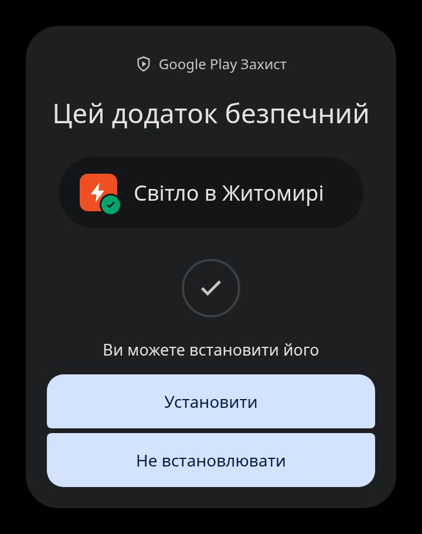
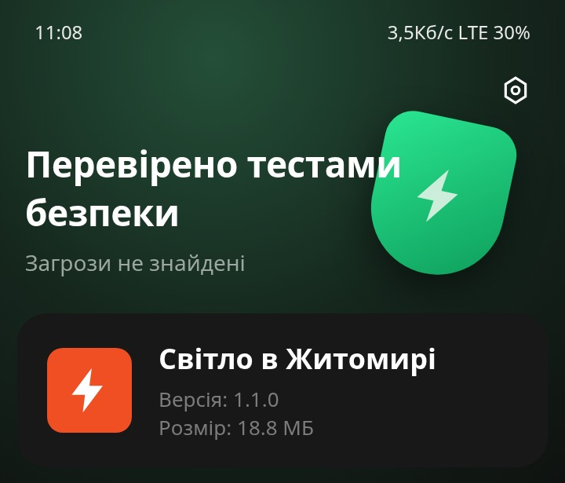
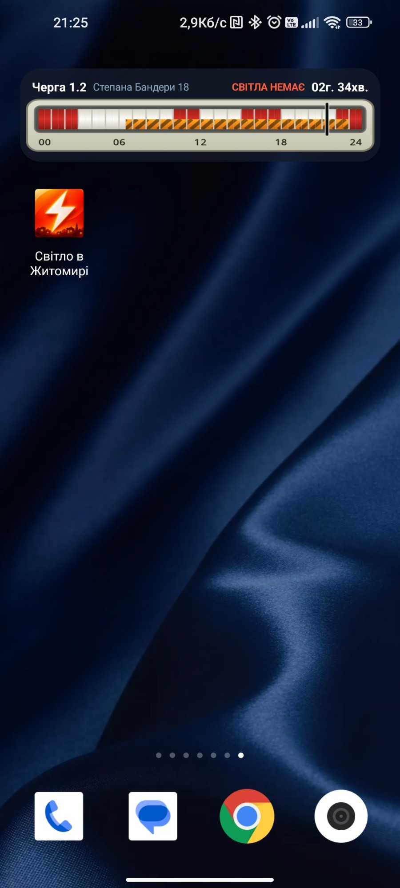
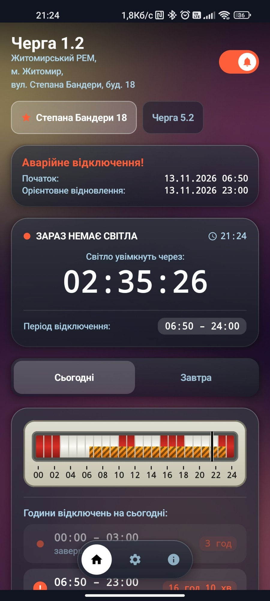
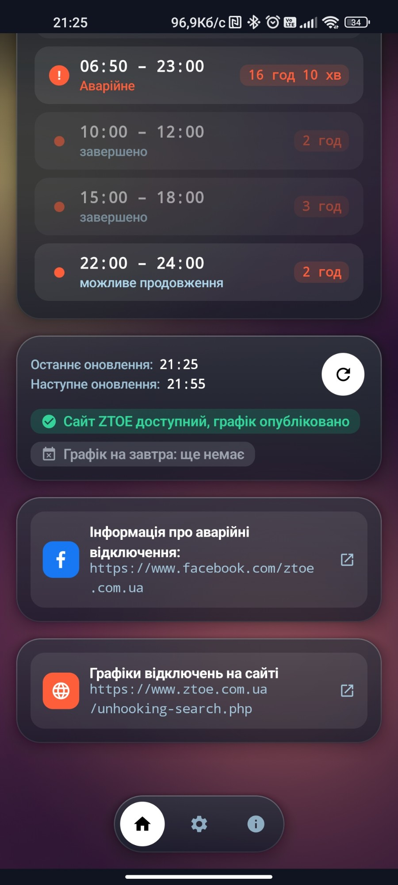
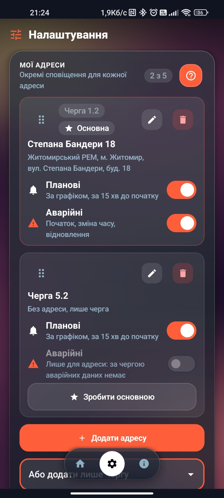
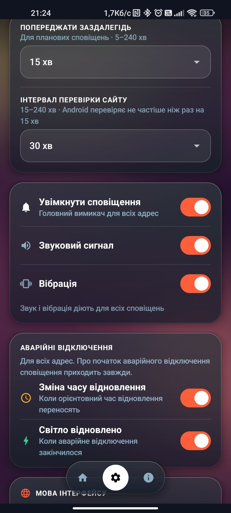
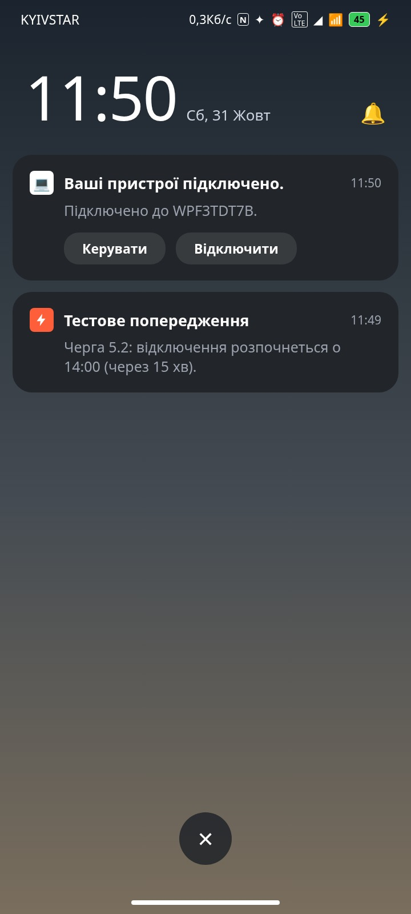
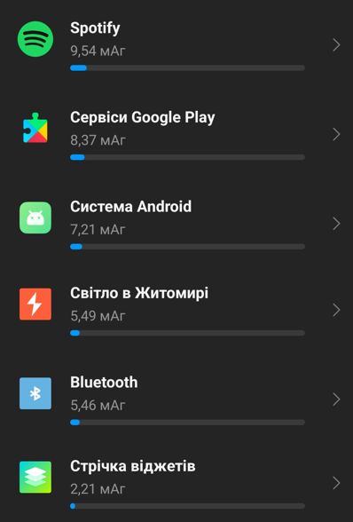

#  Світло в Житомирі

<!-- LATEST_RELEASE_START -->
## Завантажити застосунок на телефон (Android)

**[Завантажити останню версію APK (v1.4.0)](https://github.com/IgorZaharov/Android-ZTBlackoutPreWarning/releases/latest/download/app-release.apk)**

Як встановити:
1. Натисніть на посилання вище на своєму Android-телефоні — файл `app-release.apk` завантажиться автоматично.
2. Відкрийте завантажений файл (у сповіщеннях браузера або в папці «Завантаження» / «Downloads»).
3. Якщо телефон запитає дозвіл на встановлення з невідомих джерел або Google Play Захист покаже попередження, натисніть **«Все одно встановити»** (**«Install anyway»**).

Файл `.apk` успішно пройшов перевірки безпеки (Google Play Захист та системний антивірусний сканер Android), загроз не виявлено, як показано на скріншотах нижче:

| Google Play Захист (`sec1.jpg`) | Перевірка безпеки (`sec2.jpg`) |
|:---:|:---:|
|  |  |
<!-- LATEST_RELEASE_END -->

---

Android-застосунок, який стежить за графіком погодинних відключень електроенергії від **АТ «Житомиробленерго»** і за аварійними відключеннями за вашою адресою та попереджає про них заздалегідь. Показує, скільки лишилося до відключення (або до повернення світла), малює 24-годинну шкалу дня й має віджети для робочого столу.

Графіки беруться зі сторінки [ztoe.com.ua/unhooking-search.php](https://www.ztoe.com.ua/unhooking-search.php), аварійні та планові ремонтні відключення за адресою — із сервісу PowerOn «Житомиробленерго». Це неофіційний застосунок і він не пов'язаний із «Житомиробленерго».

Продовження десктопного проєкту [UABlackoutPreWarning](https://github.com/IgorZaharov/UABlackoutPreWarning).

---

## Інтерфейс застосунку (UI)

| Віджети (`UI1.jpg`) | Головний екран (`UI3.jpg`) | Розклад на день (`UI5.jpg`) |
|:---:|:---:|:---:|
|  |  |  |

| Мої адреси (`UI4.jpg`) | Сповіщення та аварійні (`UI6.jpg`) | Сповіщення (`UI2.jpg`) |
|:---:|:---:|:---:|
|  |  |  |

---

## Можливості

- **Кілька адрес.** До 5 адрес або черг («Мої адреси»): для кожної окремо вмикаються планові й аварійні сповіщення, одна з них основна. Порядок змінюється перетягуванням, на головному екрані між адресами перемикають чипи.
- **Пошук адреси.** РЕМ, населений пункт, вулиця й будинок вибираються зі списків сайту ZTOE з пошуком; черга будинку визначається автоматично.
- **Графік для вашої черги.** Застосунок завантажує таблицю відключень, знаходить рядок черги (1.1–6.2) і виділяє періоди без світла на сьогодні та, коли він опублікований, на завтра. Відключення через північ показується одним блоком.
- **Аварійні відключення.** Для адреси застосунок перевіряє PowerOn: аварійні відключення з орієнтовним часом відновлення та планові ремонтні роботи з'являються на шкалі (аварійне займає нижню половину, щоб було видно графік під ним) і в списку годин.
- **Зворотний відлік.** Великий таймер до найближчого відключення або до відновлення живлення, плюс шкала доби з маркером поточного часу. Стан сайту ZTOE показано окремо: збій сайту ніколи не стирає збережений графік.
- **Попередження заздалегідь.** Сповіщення за 5–240 хвилин до відключення, з точним спрацюванням через `AlarmManager`; кілька адрес на одній черзі отримують одне спільне сповіщення. Про аварійні відключення приходить сповіщення про початок, а за бажанням і про зміну часу відновлення та про відновлення світла. Якщо аварійне й планове відключення йдуть підряд, сповіщення приходить лише про початок усього відключення. Головний вимикач, звук і вібрація — у налаштуваннях.
- **Віджети Glance: малий 2×1, великий 4×2 і «Графік» 4×1.** Показують чергу, статус, таймер, 24-годинну шкалу й наступне відключення, мають кнопки оновлення та вмикання/вимкнення сповіщень; дотик відкриває застосунок. Кожен віджет може показувати основну або будь-яку іншу вибрану адресу.
- **Частота оновлення і перемальовування віджета.** Віджет оновлюється:
  1. Автоматично у фоні через `WorkManager` (`ScheduleSyncWorker`) відповідно до вибраного в налаштуваннях інтервалу перевірки сайту (за замовчуванням кожні **30 хвилин**, діапазон 15–240 хв) та системного таймера `AppWidgetManager`.
  2. Точно в момент початку та завершення кожного періоду відключення і під час спрацювання попереджувального будильника (`AlarmReceiver`).
  3. Миттєво при натисканні кнопки оновлення на самому віджеті, відкритті застосунку або зміні черги чи налаштувань.
- **Вигляд.** Напівпрозорі «скляні» картки на фоні, що повільно змінюється протягом доби, плавне перегортання екранів, українська й англійська мови (за замовчуванням мова системи).

## Використання батареї (Battery Usage)

Застосунок спроєктовано з акцентом на енергоефективність і він не має суттєвого впливу на розряд акумулятора. Посекундний таймер зворотного відліку працює лише тоді, коли вікно застосунку відкрите на екрані (`Lifecycle.State.RESUMED`), а у фоновому режимі використовується лише періодична синхронізація `WorkManager` та точні події `AlarmManager`.

За результатами тестування на реальних пристроях очікуване споживання заряду становить у межах **~5,5mA на годину** (близько `0,11%` при розряджанні 5000mAh батареї від 100% до 0%), що приблизно рівно споживанню залишеного ввімкненим модуля Bluetooth.

| Деталі використання батареї (`battery1.png`) | 
|:---:|
|  |

## Вимоги

- Android 8.0+ (API 26)
- Доступ до інтернету. Дозвіл на сповіщення (Android 13+) і точні будильники потрібні для попереджень.

## Збірка

Потрібні JDK 17 та Android SDK (compileSdk 36). Найпростіше відкрити папку `android/` в Android Studio.

З командного рядка:

```bash
git clone https://github.com/IgorZaharov/Android-ZTBlackoutPreWarning.git
cd Android-ZTBlackoutPreWarning/android

gradle assembleDebug     # app/build/outputs/apk/debug/app-debug-*.apk
gradle bundleRelease     # app/build/outputs/bundle/release/app-release.aab
```

У репозиторії немає `gradle-wrapper.jar`, тому `./gradlew` не запрацює без нього. Використовуйте встановлений Gradle 8.11.1 (як у CI) або згенеруйте wrapper командою `gradle wrapper`.

Release-збірка поки підписується debug-ключем (`app/build.gradle.kts`). Для публікації в Google Play підставте власний keystore.

GitHub Actions ([`.github/workflows/build-apk.yml`](.github/workflows/build-apk.yml)) збирає debug APK та release AAB при кожному push і pull request у `main` і зберігає їх як артефакти запуску.

## Як це працює

1. `ScheduleSyncWorker` через `OutageRepository` завантажує сторінку ZTOE (`ZtoeParser`, дозволені лише адреси `ztoe.com.ua`) і для кожної адреси опитує PowerOn (`PowerOnClient`). Збій одного джерела не стирає дані іншого.
2. Чисте ядро `core/` (`OutageEngine`, `EmergencyLedger`, `Subscriptions`) зводить усе в один список відключень, об'єднує суміжні в один блок і планує по одному сповіщенню на блок (`AlarmReceiver`); `AlertRegistry` запам'ятовує, про що вже сповіщено.
3. Головний екран і віджети рахують таймер і шкалу з тих самих даних, тому показують однакові значення. Правила описані в [`spec/`](spec/) і перевіряються однаковими тестовими прикладами на Android і у веб-симуляторі.
4. Налаштування зберігаються локально в `SharedPreferences`. Застосунок не збирає й нікуди не відправляє особисті дані.

## Структура репозиторію

```
android/                     Android-проєкт (Kotlin, Jetpack Compose)
  app/src/main/java/ua/blackout/prewarning/
    data/                    модель, парсер ztoe.com.ua, репозиторії
    notification/            AlarmReceiver, канали сповіщень
    worker/                  фонова синхронізація, відновлення після перезавантаження
    widget/                  віджет Glance і кнопка перемикання
    ui/                      екрани, компоненти, теми, локалізація
src/, index.html, vite.config.ts
                             веб-симулятор інтерфейсу (React + Vite), згенерований у AI Studio
scripts/                     допоміжні скрипти
```

Веб-симулятор потрібен лише для перегляду дизайну, у збірці застосунку він не бере участі. Запуск: `bun install && bun run dev`.

## Стек

Kotlin 2.0, Jetpack Compose + Material 3, Glance 1.1, WorkManager 2.10, Jsoup 1.18, Navigation Compose, Kotlin Coroutines. Збірка на AGP 8.7.

## Автор

Ігор Захаров ([@IgorZaharov](https://github.com/IgorZaharov)). Помилки й пропозиції надсилайте в [Issues](https://github.com/IgorZaharov/Android-ZTBlackoutPreWarning/issues).
