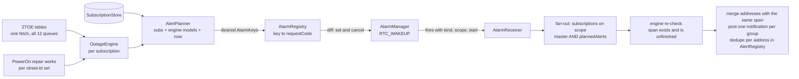
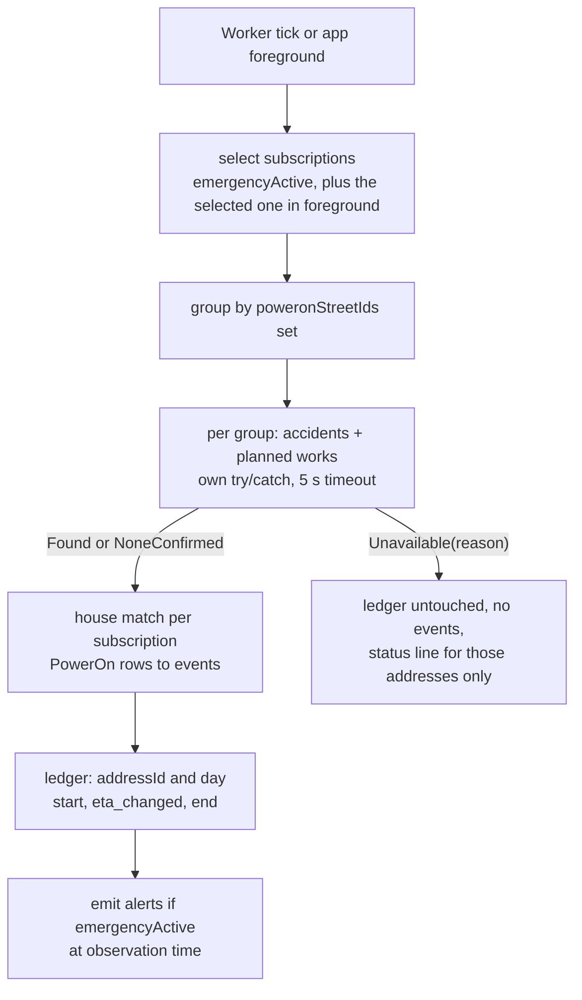
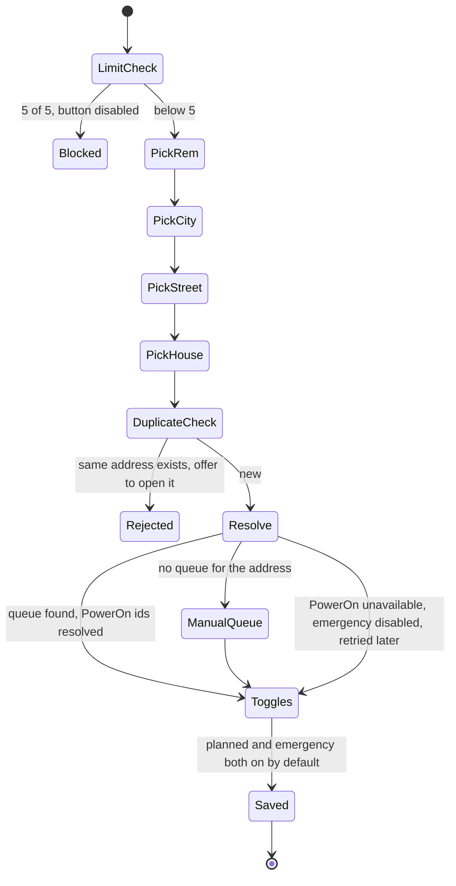

# Multi-address subscriptions — logic draft

Status: **in progress.** Owner decisions recorded 2026-11-13 ([section 14](#14-owner-decisions-2026-11-13)). Step 1 (store and migration), step 2 (Settings card, master switch, primary mirror), step 3 (alerts for every address), step 4 (Main address switcher) and step 5 (one address per widget) are implemented, see `spec/SUBSCRIPTIONS.md`. Step 3 is simpler than sections 4–6 in these points: one alarm per **queue and span** with key `planned_q<queue>_<start>_<end>` (a repair work that changes an address' span gives it its own group instead of a separate `REPAIR` scope); request codes come from the existing `AlarmCodes` registry; the receiver recomputes the groups and posts every pending group with the alarm's start; per-address `setGroup` and the 400 soft cap (at most 5 x 48 alarms) are not built; ledgers stay keyed by the address key. Sound and vibration follow the master only. Step 4 differs from section 8 in these points: the chip row sits under the global banners and above the emergency banner and hero (not directly above the day tabs), because choosing an address changes the hero too; chips follow the list order of the Settings card; the tap extra `EXTRA_SUBSCRIPTION_ID` is on every alert (section 5); the ZTOE re-check of a house without a queue still runs for the primary only. The "no address has alerts" caption is shown in Settings and on Main. Step 5 differs from section 7 in these points: the binding lives in SharedPreferences `zt_widget_bindings_v1` keyed by app widget id (not in the Glance state), so the alarm planner and the refresh read it synchronously; a removed binding is not rewritten, it resolves to the primary at draw time; the label is shown with two or more addresses, and with one address only after such a fallback. The web simulator has one binding for all three simulated widgets. v1.4.0 builds only the foundations listed in [section 13](#13-what-v140-builds-and-what-comes-later); the feature itself is a later release (plan M6 for iOS, a matching Android release before or with it).
Look: [`multi-address-mockup.html`](multi-address-mockup.html) (screenshot: [`multi-address-mockup.png`](multi-address-mockup.png)).
Owner brief: *"Draft the logic and a UI mockup for subscribing to several addresses, each with separate notification toggles. Example: all notifications for address A, only emergency for address B."*

Vocabulary used below: **span** = merged outage interval (planned ∪ repair ∪ emergency, merged across midnight, see plan 5.3); **planned** = ZTOE schedule + PowerOn planned repair works (plan decision "fold into Planned"); **emergency** = PowerOn `switchSubReason != 2` rows; **A / B** = the two example addresses.

---

## 1. Goals and non-goals

| Goals | Non-goals (this draft / v1.4.0) |
|---|---|
| Up to 5 addresses, each with its own queue, label and two switches: **Планові** and **Аварійні** | Any shipped UI, storage or alarm change for multi-address in 1.4.0 |
| Global master switch stays a kill switch; sound and vibration stay global | Per-address sound, vibration, advance time or quiet hours |
| One alarm per (scope, span) no matter how many addresses share it | Server, accounts, push (plan 5.4 option C is a separate decision) |
| Planned side costs **zero extra network** for more addresses (one ZTOE page holds all 12 queues) | Sharing subscriptions between devices, import/export |
| Same model on Android, web simulator and iOS | Groups of addresses, per-address widgets beyond the binding in section 7 (reordering was added after step 5 at the owner's request: `move` in `spec/SUBSCRIPTIONS.md` section 4) |

Design rule: **toggles control notifications only, never what is shown.** A switched-off address still has its schedule, drum and emergency banner on screen.

## 2. Data model

> **Implemented differently in step 1** (`spec/SUBSCRIPTIONS.md`, 2026-11-13): the address keeps what 1.4.0 really stores (`remSlug`, one canonical `streetId` plus its `streetName`, `house`, `text`); merged street ids resolve through the lookup, PowerOn ids stay in the outage state store (`ids_<address key>`), and `label` is empty for "automatic". The block below is the original draft.

```kotlin
// pure model, lives in core/ (no Android types); mirrored in src/core and Swift Core/
data class AddressRef(
    val remId: String,              // ztoe rem_id, e.g. "7" = Житомирський
    val remSlug: String,            // key into spec/rems.json (stable across platforms)
    val settlementId: String,       // ztoe naspunkt_id
    val streetIds: List<String>,    // all ztoe vulica_id values merged by StreetKey (plan 5.2)
    val streetKey: String,          // StreetKey canonical form
    val house: String,              // as displayed, e.g. "16А"
    val houseKey: String,           // folded for matching: 16A == 16А, "14/а"
    val remName: String, val settlementName: String, val streetName: String // display snapshot
)

enum class QueueSource { LOOKUP, MANUAL }

data class Subscription(
    val id: String,                 // short random, never reused ("k3f9x2qd"); part of every alert key
    val label: String,              // default "Київська 77", editable
    val address: AddressRef?,       // null = queue-only subscription (no address shared)
    val queue: String?,             // "5.2"; null when ZTOE reports no queue for the address
    val queueSource: QueueSource,
    val poweronCityId: Int?,        // resolved lazily by PowerOnIdResolver
    val poweronStreetIds: List<Int>,// empty = not resolved / unavailable
    val plannedAlerts: Boolean = true,
    val emergencyAlerts: Boolean = true,
    val createdAt: Long
)

data class SubscriptionStore(
    val schemaVersion: Int = 1,
    val primaryId: String?,         // exactly one when items is non-empty
    val items: List<Subscription>   // 0..5
)
```

Storage: one SharedPreferences string `zt_subscriptions_v1` (JSON, about 600 bytes per item). Other per-address data is **not** in prefs (plan 5.4 #9): ledger and address index are versioned JSON files; the id is the folder key. Writes go through targeted setters (`setPlanned(id, v)`, `setEmergency(id, v)`, `setPrimary(id)`, `add`, `remove`) that read-modify-write under one lock; UI, widgets and the worker observe the same prefs listener as today.

```json
{
  "schemaVersion": 1,
  "primaryId": "k3f9x2qd",
  "items": [
    {"id": "k3f9x2qd", "label": "Київська 77", "queue": "5.2", "queueSource": "LOOKUP",
     "address": {"remId": "7", "remSlug": "zhytomyr", "settlementId": "…", "streetIds": ["…"],
                 "streetKey": "вул.київська", "house": "77", "houseKey": "77",
                 "remName": "Житомирський РЕМ", "settlementName": "м. Житомир", "streetName": "вул. Київська"},
     "poweronCityId": 16657, "poweronStreetIds": [1234],
     "plannedAlerts": true, "emergencyAlerts": true, "createdAt": 1794500000000},
    {"id": "p7m2c1ab", "label": "Європейська 12", "queue": "3.1", "queueSource": "LOOKUP",
     "address": {"remId": "3", "remSlug": "berdychiv", "…": "…"},
     "poweronCityId": 1111, "poweronStreetIds": [5678],
     "plannedAlerts": false, "emergencyAlerts": true, "createdAt": 1794500600000}
  ]
}
```
(`…` marks elided fields, so this is a sketch and not strictly valid JSON; ids and street ids are illustrative; `remSlug` values come from `spec/rems.json`.)

Invariants (validated on read, repaired by dropping the offending item, never by crashing): `items.size <= 5`; ids unique; exactly one primary if any item; at most one item per `(remId, settlementId, streetKey, houseKey)`; `queue` matches `^[1-6]\.[12]$`.

### Effective switches (derived, never stored)

```
plannedActive(sub)   = master AND sub.plannedAlerts   AND sub.queue != null
emergencyActive(sub) = master AND sub.emergencyAlerts AND sub.poweronStreetIds.isNotEmpty()
dataVisible(sub)     = true                      // toggles never hide data
anyAlertsEnabled     = master AND items.any { it.plannedAlerts || it.emergencyAlerts }
                                                  // keeps today's rule that greys out sound/vibration
```
A queue-only subscription (or one whose PowerOn ids cannot be resolved) shows the "Аварійні" row disabled with the reason; its stored value is kept so it re-activates when ids resolve.

## 3. Mapping to today's toggles

| Today (`UserSettings`, prefs key) | Multi-address | Notes |
|---|---|---|
| `notificationsEnabled` (`notifications_enabled`) | `Subscription#1.plannedAlerts` | the Main-header bell moves to `alertsMaster` (decision 4) |
| `emergencyNotificationsEnabled` (`emergency_notifications_enabled`) | `Subscription#1.emergencyAlerts` | |
| *(new)* | `alertsMaster` (`alerts_master_enabled`) | the "Увімкнути сповіщення" row of the existing master card and the Main-header bell; kill switch for **all** alerts, planned and emergency (decision 1) |
| `soundEnabled`, `vibrationEnabled`, `prev_*` | unchanged, global | choose the channel variant exactly as now |
| `advanceNoticeMinutes` (15), `refreshIntervalMinutes` (30) | unchanged, global | CLAUDE.md invariants |

Matrix (rows are evaluated top to bottom, first match wins):

| master | `plannedAlerts` | `emergencyAlerts` | Planned alarms for this address | Emergency polling for alerts | Emergency notifications |
|---|---|---|---|---|---|
| off | any | any | cancelled (not muted) | stopped | none |
| on | on | on | scheduled | on | yes |
| on | on | off | scheduled | off (foreground fetch still feeds the banner) | none |
| on | off | on | **not scheduled** | on | yes |
| on | off | off | not scheduled | off | none |

### Worked example (the brief)

Setup: master on. **A** = Київська 77, queue 5.2, planned on, emergency on. **B** = Європейська 12, queue 3.1, planned off, emergency on.

| Situation | A gets | B gets | Why |
|---|---|---|---|
| Planned outage on queue 5.2 (23:00-01:00) | **Yes** — one alert at 22:45 "Київська 77 — Відключення о 23:00, орієнтовно до 01:00 (2 год)" | no | alarm `SCHEDULE\|q:5.2\|…23:00` exists because A wants planned; B is on another queue |
| Planned outage on queue 3.1 | no | **no** | B has planned off and nobody else is on 3.1, so **no alarm is scheduled at all**; B's drum and list still show it |
| Emergency at A's street/house | **Yes** — start, time change, restored | no | `emergencyActive(A)`; house match is per subscription |
| Emergency at B's street/house | no | **Yes** — "Європейська 12 — Аварійне відключення" | `emergencyActive(B)` |
| Master switch off | no | no | kill switch, per-address values kept |

Variant to cover the shared-queue case: if B were also on queue 5.2 with planned off, the alarm would still exist (A wants it), the fan-out would skip B, and only A is notified. With planned **on** for both, one merged alert is posted: "Київська 77 · Європейська 12 — Відключення о 23:00, орієнтовно до 01:00 (2 год)" (decision 3, section 5).

## 4. Alarm design

### 4.1 Keys and dedupe
Planned data comes from two places with different scope, so the key has a scope part (the plan's "(queue, block)" is the first form; repair works need the second):

```
AlarmKey = kind | scope | startInstant(Kyiv, minute precision)
  SCHEDULE | q:5.2         | 2026-11-13T23:00   ZTOE-derived span, shared by every subscription on queue 5.2
  REPAIR   | a:k3f9x2qd    | 2026-11-14T08:00   PowerOn planned works, address-level (street/house), not shared
```
* A REPAIR key is dropped when its start lies inside or touches a SCHEDULE span of the same queue (the merged span is alerted once from the schedule start, text computed from the merged span). Same rule as "planned + emergency overlap keeps the planned alert" (plan 5.1).
* Emergencies never get alarms (no known future start); they come from polling.
* The *alert* identity is separate and finer: `planned_{addressId}_{spanStartInstant}` in `AlertRegistry`. Alarm = per scope, dedupe = per address, notification = per merge group (section 5).

### 4.2 Registry instead of `hashCode()`
`AlarmRegistry` (JSON file `alarm_registry_v1.json`, **excluded from backup**) maps `AlarmKey -> requestCode`, allocated from a monotonic counter and freed on cancel or fire. Today's code derives request codes with `blockId.hashCode()` / `transitionId.hashCode()`; a collision silently overwrites one alarm, which with 5 addresses is no longer negligible. Belt and braces: the `PendingIntent`'s `Intent` carries a unique data URI `alert://SCHEDULE/q:5.2/202611132300` (identity by `filterEquals`, not by request code alone), flags `IMMUTABLE | UPDATE_CURRENT`.

### 4.3 Plan, fire, fan out



`AlertPlanner.plan(subscriptions, models, now)` is pure and returns the *desired set*; applying it is an idempotent diff against the registry (cancel what is no longer wanted: address removed, toggle off, schedule changed, queue changed). It runs on app start, any settings change, each successful fetch, boot, the exact-alarm permission-state broadcast and the midnight re-sync alarm. The receiver never trusts the alarm payload alone: it re-asks the engine, so "never warn about a finished slot" (plan 5.1) holds per address.

### 4.4 Budget (Android 12+ caps an app at 500 pending alarms)

| Item | Count |
|---|---|
| Distinct queues with at least one `plannedActive` subscription, **Q** | at most 5 (one per address) |
| Spans per queue in the two-day window, **S** | typically 6-12; theoretical maximum 48 (alternating half-hours both days) |
| REPAIR alarms | a handful (rare) |
| Widget transition alarms, midnight re-sync, worker | tens at most (widget count x transitions) |
| Realistic worst case | 5 x 12 = 60 plus overhead |
| Hard theoretical bound | 5 x 48 = 240 plus overhead |
| Plan's conservative figure (every queue subscribed) | 12 x ~24 = 288 |

All are below 500. Guard anyway: a **soft cap of 400** in `AlertPlanner` keeps the nearest alarms and drops the farthest; dropped ones return at the next re-plan (midnight re-sync and every fetch), and the drop is logged. Alarms are per queue, not per address, so two addresses on one queue cost one alarm.

### 4.5 Exact-alarm permission
Unchanged from plan 5.1: one global `ExactAlarmGate`; when missing, every alarm falls back to `setAndAllowWhileIdle` and one global banner is shown. Per-address state does not exist for permissions.

## 5. Notification identity, grouping, channels

* **Id** = stable int from the key `n|{addressId}|{kind}|{spanOrEventKey}` allocated through the same registry mechanism as request codes (no `hashCode()`); `kind` is `planned`, `emerg_start`, `emerg_eta_changed`, `emerg_end`; the key part follows `NOTIFICATIONS.md` decision 14 (`emerg_{event}_{addressKey}_{startInstant}[_{newEta}]`).
* **Group** = one per address: `setGroup("addr_{addressId}")` plus a summary notification (id key `summary|{addressId}`), `GROUP_ALERT_CHILDREN`. How the system renders a one-child group is to be verified on the emulator in the implementing phase.
* **Text** carries the address label first: `"{label} — Відключення о {HH:mm}, орієнтовно до {HH:mm} ({N} год)"`; emergency: `"{label} — Аварійне відключення"` with body "Початок {HH:mm}, відновлення орієнтовно о {HH:mm}". Midnight spans print the full duration (plan 5.3). Body minutes are computed at fire time.
* **Channels** stay per *kind and sound variant*, not per address (5 addresses x 8 variants would be unusable in system settings): the existing four planned channels (sound+vibration, sound, vibration, silent) and a separate set of four emergency channels (plan 5.1), shown under two `NotificationChannelGroup`s "Планові відключення" and "Аварійні відключення".
* **Same queue, several addresses** (decision 3): **one merged planned notification.** At fire time the fan-out collects the subscriptions that are `plannedActive` on the alarm's scope *and* whose engine span has the same start and end (a REPAIR span can extend one address' span; then that address gets its own notification). Order: primary first, then `createdAt`. Text: `"{label1} · {label2} — Відключення о …"`; with three or more, `"{label1} · {label2} +{N}"` in the title and the full list in the expanded body. Id key `n|{firstAddressId}|planned|{spanStartInstant}`; group = the first address' group. Posted only if at least one listed address has no `planned_{addressId}_{spanStartInstant}` in `AlertRegistry`; every listed address is then marked, so removing one address later never re-alerts the others. Emergencies are never merged (they are per house).
* Tap action opens Main with that address selected (`EXTRA_SUBSCRIPTION_ID`; for a merged alert, the first listed address).

## 6. Emergency polling



* Subscriptions on the same PowerOn street-id set share one request pair; house filtering is local. At most 5 groups x 2 requests (~1 KB each), run with a small parallelism limit.
* **Source failures are isolated**: a ZTOE failure never stops PowerOn and vice versa; one group failing never clears another group's ledger; `syncAlarms` always runs (plan 5.1). Tri-state result per group as in the plan: `Found | NoneConfirmed | Unavailable`. An outage leaves "active" only after a *successful* fetch no longer lists it, or after the 60-minute overdue grace.
* **Ledger** per address and day: `files/ledger/{addressId}/{yyyy-MM-dd}.json`, pruned after 2 days, deleted with the subscription.
* Events are emitted only for transitions observed while that address had `emergencyActive`. An emergency first seen while alerts were off produces no start alert and no later events for itself (avoids a stale "restored" burst after re-enabling).
* Foreground: the selected address is always fetched (banner, drum overlay) regardless of its toggle; toggles gate notifications only.

## 7. Widgets

* Each widget instance stores `subscriptionId` in its Glance state (`PreferencesGlanceStateDefinition`, key `subscription_id`). `null` = **follow primary** (default; changing the primary updates these widgets); a concrete id pins the widget to that address.
* `appwidget-provider` gets `android:configure="…WidgetConfigActivity"` and `android:widgetFeatures="reconfigurable|configuration_optional"`: on Android 12+ the widget is added immediately bound to the primary, and "reconfigure" lets the user pick another. The activity lists "Основна адреса (авто)" plus each subscription (48 px radio rows, same glass look).
* Widget alarms (transitions) come from the bound subscription's spans; two widgets on one queue share transition alarms through the registry.
* If the bound subscription is deleted, the widget falls back to follow-primary and prints the address label so the change is visible. With zero subscriptions it shows the existing "queue unselected" state.
* Widget text always shows the label (`Київська 77`) when more than one subscription exists; with one, the look is unchanged.

## 8. Main screen behaviour

* **Address switcher**: chip row above the day tabs (mockup frame 2), only when there are 2 or more subscriptions; with one address Main looks exactly as today. Up to 5 chips, horizontal scroll, 48 px high; the primary has a star. A dropdown is the fallback if a font scale of 2.0 makes chips unusable.
* Selecting an address changes queue title, address caption, hero countdown, drum, rows and the **Today/Tomorrow tabs** (tab resets to Today). Selected id is session state; cold start always shows the primary (decision 5).
* Header bell = `alertsMaster` (decision 4): one tap silences or restores every alert for every address, as the bell does today for the single address. Per-address "Планові" / "Аварійні" live in Settings only. If the master is on while no address has any toggle on, the bell shows its "on" state with a caption "Для жодної адреси сповіщення не ввімкнені" and a link to Settings, so "on" never silently means nothing.
* Site status chip row ("Сайт ZTOE доступний, графік опубліковано") is global (one site); the PowerOn line under it is per selected address.
* The exact-alarm banner and permission banners are global and appear above the switcher.

## 9. Add / edit address flow



The picker is the plan's 5.2 full-screen searchable dialog with the REM > City > Street > House breadcrumb (mockup frame 3); a duplicate check compares `(remId, settlementId, streetKey, houseKey)`. Editing = open the same flow pre-filled; the label is editable on the last step (default "Київська 77" from street + house). The old "Черга відключення" card becomes the queue field of this flow ("змінити чергу" sets `queueSource = MANUAL`). The first address added becomes primary; "Зробити основною" moves the star.

## 10. Migration from single-address settings

When the store is absent on first run of the release that ships the feature:

1. Read legacy keys: `queue`, `selected_address`, `selected_rem`, `selected_settlement`, `selected_street`, `selected_house`, `custom_queue_status_text`, `notifications_enabled`, `emergency_notifications_enabled`.
2. Address complete (all four ids) -> create **subscription #1** from it (`queueSource = LOOKUP`, `poweronStreetIds` empty until `PowerOnIdResolver` runs in the background). Only `queue` -> queue-only subscription labelled "Черга 5.2". Nothing -> empty store (queue-unselected state, as today).
3. `plannedAlerts = notifications_enabled`, `emergencyAlerts = emergency_notifications_enabled`, `alertsMaster = notifications_enabled || emergency_notifications_enabled` (this is exactly today's `anyAlertsEnabled`, so behaviour is unchanged). Both legacy toggles off -> `alertsMaster = false` and both per-address toggles stay **off**, as the user left them (decision 8). Turning the master back on then shows the "no address has alerts" caption from section 8 instead of silently doing nothing.
4. Sound, vibration, advance minutes, refresh interval: untouched.
5. ~~Subscription #1's id must equal a fixed address id (`addr_default`).~~ **Corrected in step 1:** 1.4.0 has no such id. Ledger, repairs, PowerOn ids and emergency alert keys are keyed by the address key `settlementId|StreetKey|HouseKey`, which the migrated item reproduces exactly, so they need no re-keying. Planned alert keys in 1.4.0 are `planned_<start>` without an address; the fan-out step must read those as belonging to the migrated item so no alert repeats.
6. Cancel legacy alarms once (they carry `hashCode()` request codes from the old scheme), then re-plan through the registry.
7. Keep writing the two legacy booleans from the primary for one release (rollback safety), then remove.

## 11. Edge cases

| Case | Behaviour |
|---|---|
| Two addresses on one queue | one alarm per span; one merged notification when the spans are equal, separate ones when a repair span differs (decision 3) |
| Address removed while an alarm is pending | one transaction: remove item, re-plan (cancels alarms nobody else needs), cancel posted notifications of group `addr_{id}`, delete ledger folder, widget fallback. If a stale alarm fires anyway, fan-out finds no subscriber, does nothing, frees its registry entry |
| Primary removed | oldest remaining becomes primary; none left -> empty state |
| `POST_NOTIFICATIONS` denied (Android 13+) | per-address toggles keep their values; global banner "Сповіщення вимкнені в системі" with a settings button; nothing is flipped silently |
| Exact alarms denied | inexact fallback + one global banner; toggles unaffected |
| Limit reached (5) | "Додати адресу" disabled with caption "Досягнуто ліміт: 5 адрес"; deep links toast |
| Same address added twice | rejected, offers to open the existing one; same street, different house is allowed |
| Offline | planned alarms are local and unaffected; emergency polling skipped; ledger untouched; no `end` events; per-address status "Аварійні: недоступні" |
| ZTOE reassigns a queue for an address | next re-plan cancels old-queue alarms and sets new ones; user not notified of the change (shown as a one-time caption on that address) |
| Address with no queue ("не вимикається") | `queue = null`; Планові disabled with the reason; emergency works |
| App update with pending 1.3.x alarms | migration step 6 |
| Backup/restore to a new device | subscriptions restored (prefs), registry and ledger are not; first run re-plans |
| DST night, midnight crossing | engine handles it; alarm key uses the Kyiv-zone start instant |

## 12. iOS notes (plan section 9, M3 and M6)

* **Budget**: iOS keeps 64 pending local notifications. Rolling window of **40**, filled nearest-first across *all* subscriptions, rebuilt on launch, foreground, `BGAppRefreshTask` and on every settings change. 24 slots of headroom for emergency and one-offs.
* **No fire-time hook**: a local notification runs no app code when it fires, so the Android fan-out-at-fire-time idea does not exist. iOS fans out at **schedule time**: one `UNNotificationRequest` per merge group (addresses with the same span, decision 3; usually a single address), identifier `planned_{firstAddressId}_{startInstant}` (a stable id makes re-planning a replace; the group's membership is recomputed on every re-plan). Same `AlertPlan = [(key, fireAt, title, body)]` from `core/`, keys already carry the address id (plan 5.4 #5).
* Grouping: `threadIdentifier = addressId`; interruption level `.timeSensitive` for emergency (needs the capability and App Review justification); no per-kind channels, so "Планові/Аварійні" are categories plus the in-app toggles.
* Storage: `subscriptions_v1.json` in the App Group container (the widget extension reads it); same schema and invariants (`spec/PERSISTENCE.md`). Large data (index, ledger) as files, not `UserDefaults`.
* Widgets: WidgetKit `AppIntentConfiguration` with an `AppEntity` "address" (default = primary) replaces the Android configure activity; timelines come from `transitions(window)` of the bound subscription.
* Emergency stays best-effort polling (opportunistic background refresh); per-address topics `street_<id>` make option C (plan 5.4) a natural fit with several addresses.

## 13. What v1.4.0 builds and what comes later

Built now (plan 4 and 5.4), so the feature is additive later:

| Foundation | Where |
|---|---|
| `addressId` in every alert/notification/ledger key (one fixed id for the implicit address) | `AlertRegistry`, `NotificationHelper`, `EmergencyLedger` |
| `AlarmRegistry` request-code registry instead of `hashCode()` | `AlarmScheduler` |
| Separate planned and emergency channels + toggles | `NotificationHelper`, `SettingsRepository` |
| Targeted settings writes | `SettingsRepository` |
| Pure `OutageEngine` taking an address, `AlertPlan` output, `transitions(window)` | `core/` |
| Ledger per address + day | `data/repository/EmergencyLedger.kt` |
| `spec/` vectors and `spec/PERSISTENCE.md` (incl. this schema as a reserved section) | `spec/` |

Later: `SubscriptionStore` + migration, Settings card and picker integration, Main switcher, fan-out receiver, widget configure activity, web parity, then iOS M6. Suggested order: store and migration, Settings UI, planner/fan-out, Main switcher, widgets.

## 14. Owner decisions (2026-11-13)

| # | Question | Decision | vs draft default |
|---|---|---|---|
| 1 | Master vs emergency | Master is a kill switch for **both** planned and emergency | same |
| 2 | Address limit | **5** | same |
| 3 | Two addresses on one queue | **One merged notification** ("Київська 77 · Соборна 3 — …"), section 5 | **changed** (draft: two, one audible) |
| 4 | Header bell on Main | **Master switch** (`alertsMaster`), section 8 | **changed** (draft: selected address' Планові) |
| 5 | Cold start | Always the **primary** | same |
| 6 | Widget default | **Follow primary** | same |
| 7 | Advance notice | Stays **global** (15 min default) | same |
| 8 | Both legacy toggles off at migration | **Keep both per-address toggles off**, master off, section 10 step 3 | **changed** (draft: set both on) |
| 9 | Queue-only subscriptions | **Allowed**; Аварійні disabled with the reason | same |
| 10 | Labels | **Auto** from street + house, **editable** | same |

## 15. Gaps in the plan this draft had to decide

* Plan 4 says the master is a kill switch, plan 5.1 says emergency is independent of it "as today" -> decision 1: kill switch for both.
* Plan 4 keys alarms by (queue, block); PowerOn **repair works are address-level**, so a second scope `a:{addressId}` is added (4.1).
* Plan 4: "notification id = address id + kind + interval id"; plan 5.1/5.4 key emergencies by start instant and event -> unified as one key format (section 5).
* "12 queues x ~24 = 288" does not state what 24 is; with at most 5 subscriptions the real bound is 5 queues (4.4).
* `AddressRef` fields are not defined in the plan; section 2 defines them from `SelectedAddressQuery` plus the merged-id model of 5.2.
* iOS cannot fan out at fire time (plan 5.4 #5 implies alarms keyed per address are enough); section 12 makes the difference explicit.
* The plan puts the site-status chip in the "Last updated" card; the mockup follows that (frame 2, bottom card).
